# gsdb — Capstone Recap & Review

> The closing document for gsdb: what was built, how a debugger actually works, how every
> piece of this codebase implements it, which C++ it uses, and what to take away.
> Written 2026-10-13 against `d5b66d8` after reading every source file, every test, the
> README notes, `linux_signals_and_interrupts.md`, and every doc under `.claude/` and `.codex/`.
> Revised the same day: Part II (how the code fits together) and 79 diagrams added; bug
> tracking moved out to the audit and the style reviews.

---

## 0. How to read this

The document has five parts. Most sections end with **"Go deeper"** pointers into the
existing docs, which were written while you were stuck on that exact topic.

| Part | Sections | Read it when you want… |
|---|---|---|
| **I. The project** | 1–3 | the big picture: goal, scope, history, architecture, one session end to end |
| **II. How the code fits together** | 4–13 | the code map: files, the header graph, how the utility headers and `.inc` tables feed everything, class diagrams, callbacks, data pipelines, every operation traced function by function, the CLI, the tests |
| **III. How a debugger works** | 14–26 | the concepts (ptrace, registers, breakpoints, ELF, DWARF, stack, unwinding, stepping, shared libraries, threads, inferior calls) and how gsdb implements each |
| **IV. The C++** | 27–29 | the language techniques in the code, and the lessons learned |
| **V. Takeaways and review** | 30–34 | what to remember, a map of every other doc, a glossary |

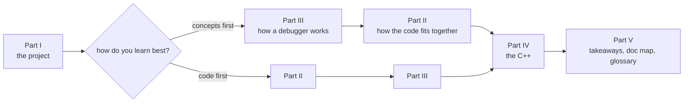

**About the diagrams.** There are 79: 58 Mermaid and 21 ASCII.
- Mermaid diagrams (flowcharts, class, sequence and state diagrams, charts) render on
  GitHub, in VS Code's Markdown preview, in Obsidian, and in Neovim Markdown preview
  plugins. All of them were checked with Mermaid 11's parser.
- ASCII diagrams (memory layouts, bit fields, byte tables) render anywhere, including a
  plain terminal.
- The class diagrams use one legend, given in §8.

Conventions used throughout:

- **Assembly is AT&T syntax**: `mnemonic src, dst`, `%` on registers, `$` on immediates,
  size suffixes (`movq`, `movl`, `movb`), memory as `disp(base, index, scale)`.
  This matches gsdb's disassembler (`ZydisDisassembleATT`).
- **Three address kinds** (gsdb has a strong type for each, §18):
  - `virt_addr`: a real address in the running inferior;
  - `file_addr`: an address as written in an ELF file;
  - `file_offset`: a byte offset into the file on disk.
- "Inferior", "tracee" and "debuggee" all mean the program being debugged. "Tracer" is gsdb.
- Code references name the **function and file** (for example `process::wait_on_signal` in
  `src/process.cpp`); line numbers rot, symbol names don't.

---

# Part I — The project

## 1. Goal and scope

**gsdb is a native Linux debugger written from scratch in C++23**, a port of Sy Brand's
`sdb` from *Building a Debugger* (No Starch Press). It drives a real process through the
`ptrace` system call, understands x86-64 machine state, reads ELF and DWARF 4 itself (no
libdwarf, no libelf, no libunwind; only Zydis for decoding instructions), and gives you a
gdb-like REPL.

### What it can do

| Area | Capability |
|---|---|
| Process control | launch (`fork` + `PTRACE_TRACEME` + `exec`) or attach (`PTRACE_ATTACH`), continue, single-step, kill/detach cleanly |
| Registers | read/write every GPR, sub-register (`%eax`, `%ax`, `%ah`, `%al`), x87 `%st0-7`, MMX `%mm0-7`, SSE `%xmm0-15`, debug registers `%dr0-7` |
| Memory | read/write inferior memory, disassemble (AT&T), hide `int3` bytes from both |
| Stop points | software breakpoints (`int3`), hardware breakpoints and watchpoints (DR0–DR7), syscall catchpoints |
| Symbols | ELF section/symbol tables, demangled C++ names, load-bias translation for PIEs |
| Debug info | DWARF 4 `.debug_info`, `.debug_abbrev`, `.debug_str`, `.debug_ranges`, `.debug_line`, `.debug_loc`, `.eh_frame`, `.eh_frame_hdr` |
| Source level | breakpoints on functions, `file:line`, or addresses; `step`/`next`/`finish` with prologue skipping and inline-function awareness |
| Stack | CFI-based unwinding through inlined frames and across shared libraries; `backtrace`, `up`, `down` |
| Shared libraries | tracks the dynamic linker's rendezvous structure, loads each `.so`'s ELF/DWARF, dumps the vDSO |
| Threads | all-stop mode: every thread stops when one does; per-thread registers, stacks, current thread |
| Variables | globals, locals (with lexical-block shadowing), members, `->`, `[i]`, bitfields, member pointers, location lists, composite (piece) locations |
| Expressions | call functions in the inferior with SysV-ABI argument passing, overload resolution, member functions, results kept as `$N` |

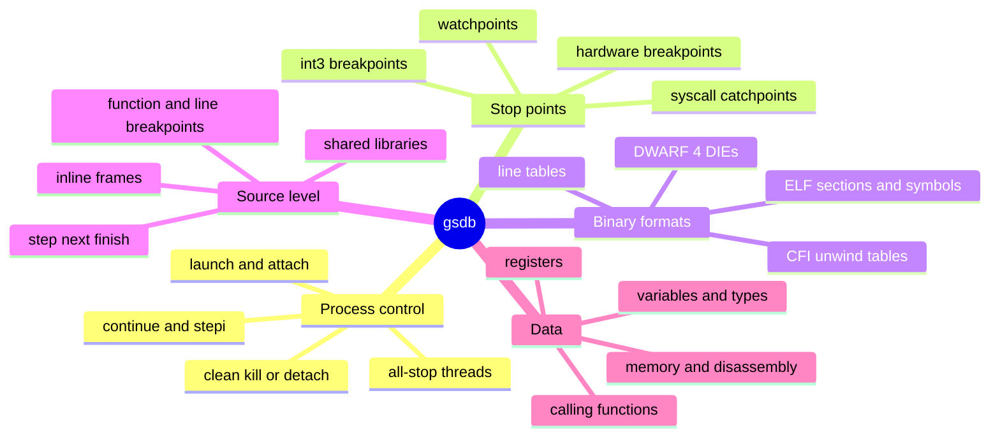

### Deliberate scope limits

- **x86-64 Linux only.** Register tables, DR7 encoding, the SysV ABI and the 4 KiB page
  assumption are all hard-coded.
- **DWARF 4, DWARF32, 8-byte addresses.** GCC ≥ 11 emits DWARF 5 by default, so the test
  targets build with `-gdwarf-4 -O0 -pie`. A plain `g++ -g` binary is rejected at load.
- **All-stop threading only**; no non-stop mode.
- **No core files, no remote targets, no TLS variables.** The unwinder reads `.eh_frame`
  only to build backtraces; it never runs C++ exception personality routines.

### By the numbers

- 92 commits, 2026-03-14 → 2026-10-12.
- About 13,000 lines of code:
  - `src/` 5.9k (`dwarf.cpp` alone 2.4k);
  - `include/` 3.1k;
  - CLI 1.2k;
  - tests 1.1k;
  - 20 small target programs.
- About 13,000 lines of notes and docs.
- 37 Catch2 test cases, 231 assertions, all passing.

## 2. How the project grew

The commit history follows the book chapter by chapter. Each row is a layer you added on
top of the previous one.

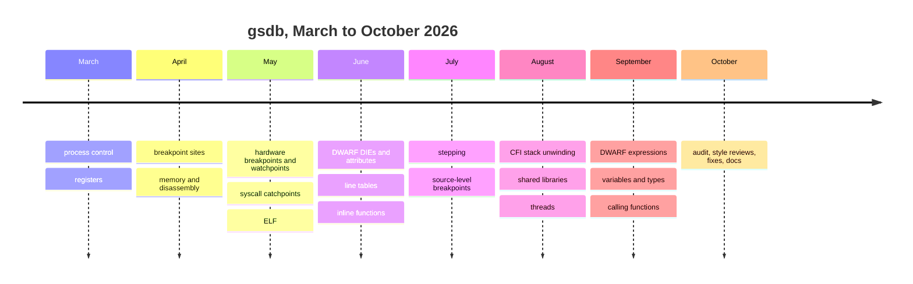


| When | Commits | Layer added |
|---|---|---|
| Mar 14–22 | `152a89c` … `d3ca875` | launch, attach, resume, tests for process control |
| Mar 22 – Apr 6 | `012c125` … `3e8d38d` | registers: `user` struct, X-macro table, assembly test targets |
| Apr 11–12 | `b4f2fbc` … `f9d9518` | breakpoint sites, continue over breakpoints |
| Apr 19–22 | `ee83168`, `2313984` | memory read/write, Zydis disassembly |
| May 11–23 | `d6a5294` … `2d22c9e` | hardware breakpoints, watchpoints, SIGINT handling |
| May 25 | `a4d0aac`, `39d43bd` | syscall catchpoints; the signals/interrupts deep dive |
| May 25–31 | `b7afafe`, `d0f578f` | ELF parser |
| Jun 13–21 | `e16560b` … `bdea89b` | DWARF DIEs, attributes, line tables |
| Jun 24 – Jul 8 | `08deccd` … `5843a27` | inline functions, stack model, step in/over/out, source breakpoints |
| Aug 8–19 | `9524c59` … `ef32937` | `%rip`/`%rsp`/`%rbp` deep dive, CFI stack unwinding |
| Aug 22–23 | `f71df69`, `6f21d12` | rendezvous structure, shared libraries |
| Aug 26 – Sep 1 | `c568999` … `2a60520` | multithreading |
| Sep 5–17 | `ce9f8c5` … `2a01148` | DWARF expressions, location lists, variables, types, visualization |
| Sep 23–30 | `a816e74` … `82fec92` | expression evaluation: argument parsing, overload resolution, inferior calls |
| Oct 5–12 | `fd6be79` … `d5b66d8` | hardening: a correctness audit, two style reviews, 13 fix commits |

## 3. Architecture

### 3.1 Layers

```
 ┌──────────────────────────────────────────────────────────────────────────────┐
 │ tools/gsdb.cpp — CLI                                                          │
 │   libedit REPL · command dispatch (prefix match) · formatting · SIGINT handler│
 └───────────────────────────────┬──────────────────────────────────────────────┘
                                 │ owns unique_ptr<target>
 ┌───────────────────────────────▼──────────────────────────────────────────────┐
 │ target  (src/target.cpp) — the SYMBOLIC layer                                 │
 │   source-level stepping · breakpoints (logical) · shared-library tracking     │
 │   variables · expression evaluation / inferior calls · per-thread stacks      │
 ├──────────────┬──────────────────────┬─────────────────────┬──────────────────┤
 │ stack        │ breakpoint (+ derived)│ elf_collection      │ type / typed_data│
 │ stack.cpp    │ breakpoint.cpp        │  └ elf (elf.cpp)    │ type.cpp         │
 │ frames, CFI  │ function/line/address │     └ dwarf          │ ABI classes,     │
 │ inline height│ → resolve() → sites   │       (dwarf.cpp)    │ visualization    │
 └──────┬───────┴──────────┬────────────┴─────────┬───────────┴──────────────────┘
        │                  │                      │ (pure file parsing: mmap)
 ┌──────▼──────────────────▼──────────────────────┴─────────────────────────────┐
 │ process  (src/process.cpp) — the MACHINE layer                                │
 │   ptrace · waitpid loop · threads · registers · memory · breakpoint_site      │
 │   watchpoint · debug registers · syscall catch policy · inferior_call         │
 └───────────────────────────────┬──────────────────────────────────────────────┘
                                 │ system calls, /proc
 ┌───────────────────────────────▼──────────────────────────────────────────────┐
 │ Linux kernel: ptrace, signals, scheduler, MMU   ·   CPU: int3, DR0–DR7, TF    │
 └──────────────────────────────────────────────────────────────────────────────┘
```

The key split is between **`process`**, which knows nothing about source code, and
**`target`**, which knows nothing about `ptrace`.

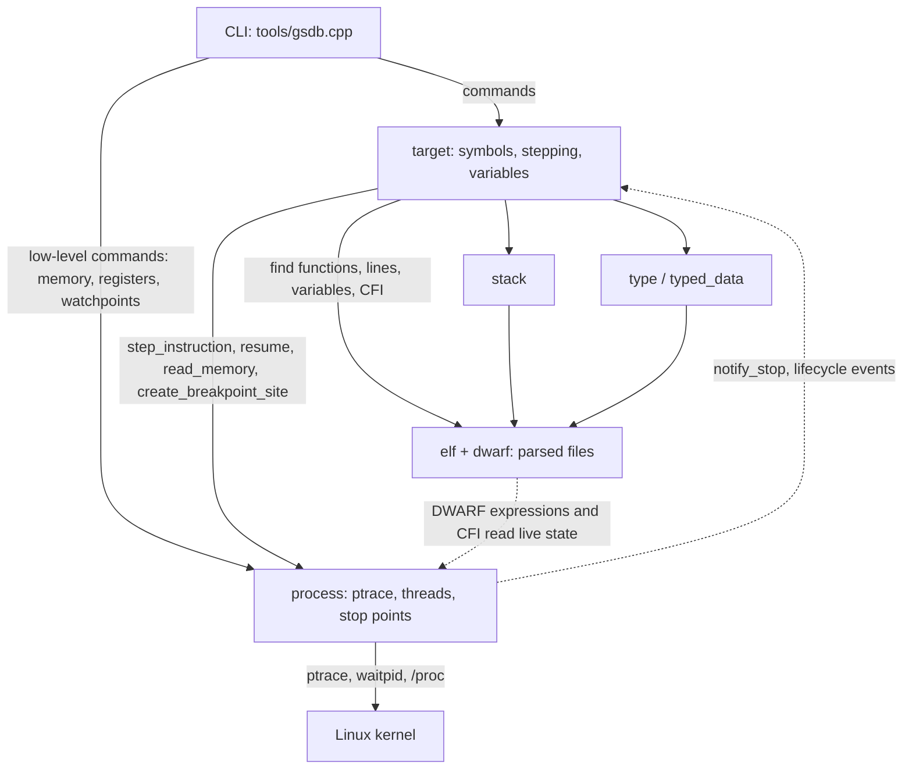

- `process` deals in PIDs, TIDs, raw addresses, bytes and registers.
- `target` deals in functions, lines, variables and types, and translates them into
  `process` operations.

ELF/DWARF parsing is a third, independent piece. It works on a file and never touches a
process, with two exceptions that must read live registers and memory, and are given a
`const process&` for it:
- DWARF expression evaluation;
- CFI unwinding.

### 3.2 Ownership

```
 main()
  └ unique_ptr<target>
     ├ unique_ptr<process>
     │   ├ unordered_map<pid_t, thread_state>        (one `registers` per thread)
     │   ├ stoppoint_collection<breakpoint_site>     OWNS sites   (unique_ptr)
     │   └ stoppoint_collection<watchpoint>          OWNS watchpoints
     ├ stoppoint_collection<breakpoint>              OWNS logical breakpoints
     │   └ each breakpoint: stoppoint_collection<breakpoint_site, false>  (raw, non-owning)
     ├ elf_collection: vector<unique_ptr<elf>>       (main exe + every .so + vDSO)
     │   └ elf: mapped_file (mmap) · section/symbol tables · unique_ptr<dwarf>
     │        └ dwarf: compile_units (each owns its line_table) · CFI · lazy indexes
     ├ unordered_map<pid_t, thread{thread_state*, stack}>
     └ vector<typed_data> expression_results_        ($0, $1, …)
```

Back-pointers run the other way as raw, non-owning pointers:
- `breakpoint_site → process`
- `breakpoint → target`
- `process → target` (`set_target`)
- `dwarf → elf`
- `compile_unit → dwarf`

They're safe because each child is destroyed before its parent.

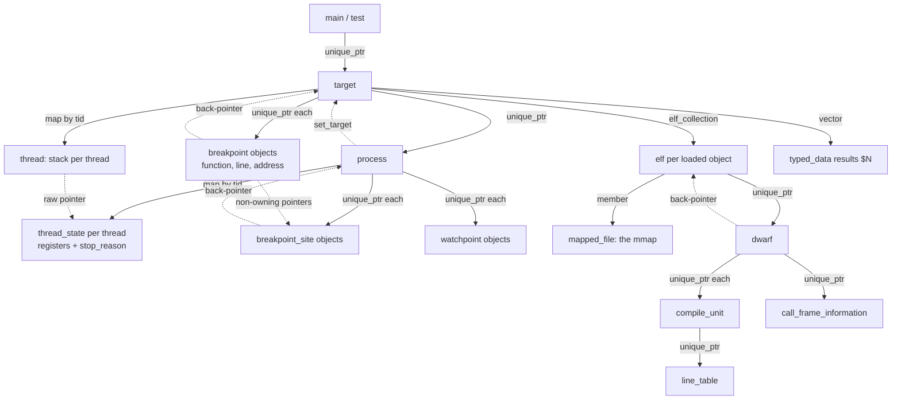

Solid arrows own; dashed arrows only point.

### 3.3 Directory and build shape

```
include/libgsdb/      public headers (+ detail/registers.inc, detail/dwarf.h constants)
src/                  libgsdb.a   (+ src/include/syscalls.inc, private)
tools/gsdb.cpp        CLI, links libgsdb + libedit
test/tests.cpp        Catch2 v3, links libgsdb; test/targets/*.cpp|.s built -g -O0 -pie -gdwarf-4
```

CMake: `gsdb::libgsdb` ALIAS target, `PUBLIC`/`PRIVATE` include dirs with
`$<BUILD_INTERFACE:…>`/`$<INSTALL_INTERFACE:…>`, install/export, `catch_discover_tests`, and
a `TARGETS_DIR` compile definition so tests find their target binaries. The Nix flake
provides GCC, CMake, Catch2, libedit and Zydis.

### 3.4 One session, end to end

What happens when you type `gsdb ./marshmallow`, set a breakpoint, continue and print a
backtrace. Every arrow below is a concept explained in Part III; Part II (§11) traces the
same steps function by function.

```
gsdb ./marshmallow
 └ target::launch
    ├ process::launch
    │   ├ pipe(O_CLOEXEC)                         error channel child→parent      §14
    │   ├ fork()
    │   │   child: setpgid(0,0) · personality(ADDR_NO_RANDOMIZE)
    │   │          PTRACE_TRACEME · execlp()  ── kernel stops it with SIGTRAP at exec
    │   └ parent: read pipe (empty = exec worked) · waitpid → stopped
    │             PTRACE_SETOPTIONS: TRACESYSGOOD | TRACECLONE | EXITKILL
    ├ create_loaded_elf: mmap the file · load bias = auxv[AT_ENTRY] − e_entry    §18
    └ internal breakpoint at AT_ENTRY, hit handler = resolve_dynamic_linker_rendezvous
                                                                                  §23
gsdb> break set libmeow_client_is_cute
 └ function_breakpoint::resolve  → DWARF index finds nothing yet (library not loaded)

gsdb> continue
 └ resume_all_threads → PTRACE_CONT
   … kernel runs ld.so, which maps libmeow.so, fills r_debug, jumps to AT_ENTRY …
   int3 at AT_ENTRY → SIGTRAP → waitpid returns
   handle_signal: PC−1 is an enabled site → rewind PC → breakpoint hit handler:
     read .dynamic from memory → DT_DEBUG → r_debug → walk link_map
     → new elf for libmeow.so, ld.so, libc, vDSO (dumped to /tmp)
     → re-resolve every breakpoint → libmeow_client_is_cute now gets a site
     → internal breakpoint on _dl_debug_state
     handler returns true → wait_on_signal resumes transparently
   … main calls libmeow_client_is_cute → int3 → SIGTRAP …
   handle_signal → rewind → target::notify_stop → stack::unwind (CFI)              §21
   stop_running_threads (all-stop)                                                 §24
 └ CLI prints the stop line and the source around it

gsdb> backtrace
```

The actual output of that session (captured 2026-10-13):

```
Launched process with PID 6833
gsdb> break set libmeow_client_is_cute
gsdb> continue
Cuteness rating: 100
Thread 6833 stopped with signal TRAP at 0x7ffff7fb60fd, libmeow.cpp:3 (libmeow.so`libmeow_client_is_cute) (breakpoint 1)
  1 extern int libmeow_client_cuteness;
  2 
> 3 bool libmeow_client_is_cute() { return libmeow_client_cuteness > 50; }
  4 
gsdb> backtrace
*[0]: 0x7ffff7fb60fd libmeow.so`libmeow_client_is_cute
 [1]: 0x5555555551fc marshmallow`main
```

Two details worth noticing:
- `0x5555555551fc` sits in the `0x5555…` range because gsdb disables ASLR, and the library
  lands near `0x7ffff7…` below the stack.
- `main`'s reported address is the start of the source line containing the `call`, not
  the return address (§21.4).

**Go deeper:** `.codex/architecture-walkthrough.md` (object model, launch/attach/continue
flows), `.claude/shared-libraries.md` §12 (this exact session with real addresses).


---

# Part II — How the code fits together

Part III explains each debugger concept. This part is the map you hold while reading it:
- which file holds what;
- which header depends on which;
- how the utility headers and generated tables feed everything else;
- how the classes reference each other;
- and, step by step, which functions call which for every user-visible operation.

## 4. The file map

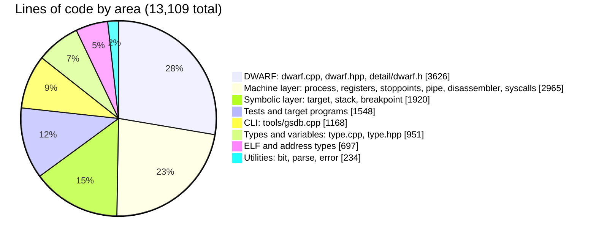

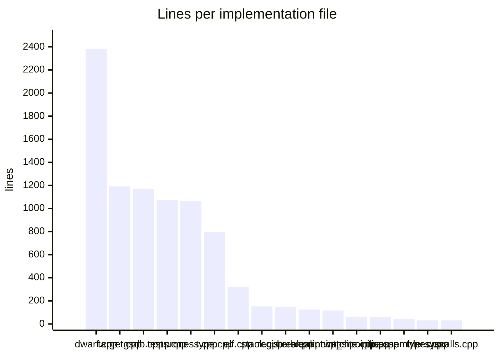

| File(s) | Layer | What lives there |
|---|---|---|
| `include/libgsdb/types.hpp`, `src/types.cpp` | foundation | `virt_addr`, `file_addr`, `file_offset`, `span<T>`, `byte64`/`byte128`, `stoppoint_mode`; address conversions (in the `.cpp`, because they need `elf`) |
| `bit.hpp` | foundation | bytes ↔ values: `from_bytes`, `as_bytes`, `to_byte_vec`, `to_byte128/64`, `memcpy_bits`, `to_string_view` |
| `parse.hpp` | foundation | text → values: `to_integral`, `to_float`, `parse_vector<N>`, `parse_vector` |
| `error.hpp` | foundation | `gsdb::error` with `send` / `send_errno` |
| `detail/registers.inc`, `register_info.hpp` | machine | the register table (X-macro) and lookups by id/name/DWARF number |
| `registers.hpp/.cpp` | machine | one thread's register file (`struct user` copy), typed read/write |
| `breakpoint_site.hpp/.cpp`, `watchpoint.hpp/.cpp` | machine | one physical stop point each (`int3` byte or debug-register slot) |
| `stoppoint_collection.hpp` | machine | the generic, concept-constrained container for all stop points |
| `pipe.hpp/.cpp` | machine | RAII pipe (exec-error channel, test output capture) |
| `process.hpp/.cpp` | machine | ptrace, the wait loop, threads, memory, debug registers, syscall policy, inferior calls |
| `disassembler.hpp/.cpp` | machine | Zydis wrapper (AT&T output) |
| `syscalls.hpp/.cpp`, `src/include/syscalls.inc` | machine | syscall name ↔ number (X-macro) |
| `detail/dwarf.h` | files | every `DW_*` / `DW_EH_PE_*` constant as unnamed `enum`s |
| `elf.hpp/.cpp` | files | the mapped ELF file, sections, symbols; `elf_collection` |
| `dwarf.hpp/.cpp` | files | the whole DWARF reader: DIEs, attributes, line tables, ranges, expressions, location lists, CFI, indexes |
| `type.hpp/.cpp` | symbolic | `type` (DWARF or builtin), `typed_data`, ABI classification, visualization |
| `stack.hpp/.cpp` | symbolic | one thread's frames, inline height, unwinding loop |
| `breakpoint.hpp/.cpp` | symbolic | logical breakpoints (function / line / address) that resolve to sites |
| `target.hpp/.cpp` | symbolic | the coordinator: owns process and ELFs, stepping, shared libraries, variables, expressions |
| `tools/gsdb.cpp` | CLI | REPL, command parsing, output formatting |
| `test/tests.cpp`, `test/targets/*` | tests | 37 Catch2 cases and the programs they debug |

## 5. Headers: who includes whom

Every arrow means "`#include`s". `types.hpp` is left out to keep the picture readable:
almost every header includes it, and it includes nothing from the project.

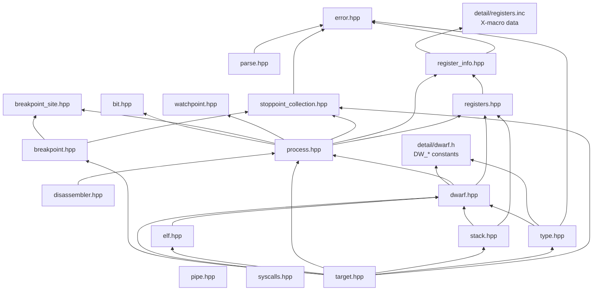

Reading it bottom-up gives the build order of ideas:

1. **Leaves.** These include nothing from the project: `types.hpp`, `error.hpp`,
   `pipe.hpp`, `syscalls.hpp`, and the two data files `detail/dwarf.h` and
   `detail/registers.inc`.
2. **Foundation.**
   - `bit.hpp` needs the byte array aliases from `types.hpp`.
   - `parse.hpp` needs `error.hpp` to throw on malformed text.
   - `register_info.hpp` pulls in the register X-macro data.
3. **Machine layer.** `registers.hpp`, the stop points, and the generic collection meet in
   `process.hpp`.
4. **File layer.**
   - `dwarf.hpp` includes `process.hpp` only because DWARF expressions and CFI evaluate
     against a live `const process&` and `registers`.
   - `elf.hpp` includes `dwarf.hpp` because an `elf` owns its `dwarf` by `unique_ptr` and
     has no out-of-line destructor.
5. **Symbolic layer.** `stack.hpp`, `type.hpp` and `breakpoint.hpp` build on the file layer.
6. **The top.** `target.hpp` includes everything. It's the coordinator.

### 5.1 How the cycles are broken

Several classes need to know about each other in *both* directions. For example,
`process` calls back into `target`, `file_addr` needs `elf`, and a `breakpoint_site` knows
its parent `breakpoint`. Including headers both ways would be circular, so the code uses
the standard C++ technique:

> **The header forward-declares; the `.cpp` includes the full definition.**

| Header | Forward-declares | Uses it as | The `.cpp` that includes the real header |
|---|---|---|---|
| `types.hpp` | `class elf; class elf_collection; class file_addr;` | `const elf*` member, parameter types | `types.cpp` includes `elf.hpp` to implement `to_virt_addr`/`to_file_addr` |
| `registers.hpp` | `class process;` | `process*` member, `friend process` | `registers.cpp` includes `process.hpp` to call `write_fprs/gprs/user_area` |
| `breakpoint_site.hpp` | `class process; class breakpoint;` | `process*`, `breakpoint* parent_` | `breakpoint_site.cpp` includes `process.hpp` |
| `watchpoint.hpp` | `class process;` | `process*` | `watchpoint.cpp` includes `process.hpp` |
| `process.hpp` | `class target;` | `target* target_` | `process.cpp` includes `target.hpp` to call `notify_stop` / `notify_thread_lifecycle_event` |
| `breakpoint.hpp`, `stack.hpp` | `class target;` | `target*` | `breakpoint.cpp`, `stack.cpp` include `target.hpp` |
| `dwarf.hpp` | `class elf; class compile_unit; class die; class type;` | `const elf*`, return types | `dwarf.cpp` includes `elf.hpp` and `type.hpp` |
| `target.hpp` | `class typed_data;` | (then includes `type.hpp` anyway) | — |

A pointer or reference to an incomplete type is fine in a declaration. Only code that
dereferences it, calls a member or needs `sizeof` must see the full class. That code
lives in the `.cpp`.

The pattern also explains a lot of the **"downward header, upward `.cpp`"** shape you
see:
- `process.hpp` knows nothing about `target`;
- `process.cpp` calls `target_->notify_stop(...)`.

### 5.2 Which `.cpp` reaches into which header

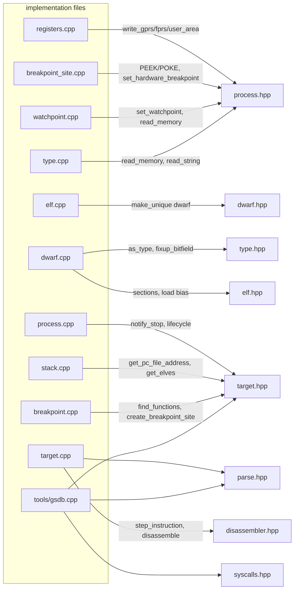

## 6. The foundation headers, and who uses them

These four headers hold no state. They're the vocabulary every other file speaks.

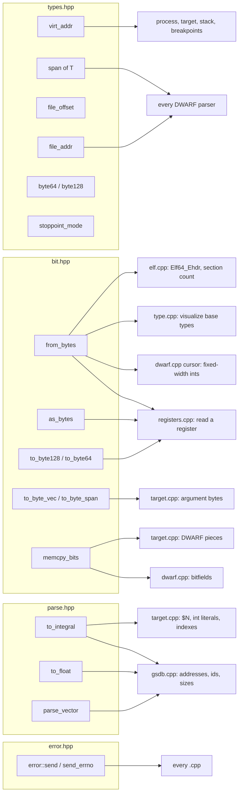

Measured uses:

| Utility | Main users (number of uses) | Why it exists |
|---|---|---|
| `from_bytes<T>` | `type.cpp` (18), `registers.cpp` (10), tests (11), `dwarf.cpp`, `elf.cpp`, `process.cpp` | the **one** sanctioned way to turn raw bytes into a typed value (`memcpy`, so no aliasing or alignment UB) |
| `as_bytes` | `registers.cpp`, tests | view any object as `std::byte*` to copy into or out of it |
| `to_byte_vec` | `target.cpp` (11) | pack an argument value (an address, an `int64`, a `double`) into `typed_data`'s byte vector |
| `to_byte128` / `to_byte64` | `registers.cpp` (`widen`), tests | zero-padded register-sized buffers |
| `memcpy_bits` | `dwarf.cpp` (`fixup_bitfield`), `target.cpp` (`read_location_data`) | copy at bit granularity for bitfields and `DW_OP_bit_piece` |
| `to_integral` / `to_float` | `gsdb.cpp` (20), `target.cpp` | parse user text, with `0x` stripping and full-consumption checks |
| `parse_vector<N>` / `parse_vector` | `gsdb.cpp` | `[0xff,0x01]` byte lists for vector registers and `memory write` |
| `error::send` | `dwarf.cpp` (39), `target.cpp` (27), `process.cpp` (26), `type.cpp` (12), … | one exception type for everything gsdb itself rejects |
| `error::send_errno` | `process.cpp` (17), `breakpoint_site.cpp`, `elf.cpp`, `pipe.cpp` | turn a failed syscall's `errno` into that exception |
| `virt_addr` / `file_addr` | everywhere (`target.cpp` 33 / 15 uses, `dwarf.cpp` 10 / 30, tests 32 / 27) | address vocabulary; the compiler keeps the two kinds apart |

**How the address types connect to `elf`.**
- `file_addr` carries a `const elf*`.
- `file_addr::to_virt_addr()` and `virt_addr::to_file_addr(const elf&)` live in
  `types.cpp`, call `elf::get_section_containing_address(...)` and `elf::load_bias()`, and
  return a default (null) address if no section matches.
- `virt_addr::to_file_addr(const elf_collection&)` first asks the collection which ELF
  contains the address. This is the single entry point every "which library is this PC
  in?" question goes through.

**`span<T>`** is gsdb's own minimal `std::span`. It's a pointer plus size, with a
converting constructor from `std::vector`. Every parser gets one from
`elf::get_section_contents(name)` and narrows it with
`span{begin + offset, end}`, so the bytes are never copied.

## 7. Generated tables: the `.inc` files and `detail/dwarf.h`

Three files are mostly **data**. Two are X-macro tables, which are included more than once
and expanded differently each time. One is a constant header.

### 7.1 `detail/registers.inc` → the register table

```
 registers.inc (one line per register)          register_info.hpp, expansion #1        expansion #2
 ─────────────────────────────────────          ───────────────────────────────        ──────────────────────────────────────────
 DEFINE_GPR_64(rax, 0),                 ──►     enum class register_id {         ──►   inline constexpr register_info g_register_infos[] = {
   = DEFINE_REGISTER(rax, 0, 8,                   rax,                                   {register_id::rax, "rax", 0, 8,
       GPR_OFFSET(rax),                           rdx, …                                  offsetof(user, regs) + offsetof(user_regs_struct, rax),
       register_type::gpr,                        dr7                                     register_type::gpr, register_format::uint},
       register_format::uint)                   };                                       …
                                                #define DEFINE_REGISTER(name,…) name     };   #define DEFINE_REGISTER(name, …) {register_id::name, #name, …}
```

`registers.inc` itself defines small helper macros that all expand to `DEFINE_REGISTER`.
Each one computes the offset and size differently:

| Helper | Size | Offset | Format |
|---|---|---|---|
| `DEFINE_GPR_64(name, dwarf)` | 8 | `GPR_OFFSET(name)` | uint |
| `DEFINE_GPR_32/16(name, super)` | 4 / 2 | `GPR_OFFSET(super)` (same start byte) | uint, DWARF id −1 |
| `DEFINE_GPR_8H(name, super)` | 1 | `GPR_OFFSET(super) + 1` | uint |
| `DEFINE_GPR_8L(name, super)` | 1 | `GPR_OFFSET(super)` | uint |
| `DEFINE_FPR(name, dwarf, user_name)` | `sizeof(user_fpregs_struct::user_name)` | `FPR_OFFSET(user_name)` | uint |
| `DEFINE_FP_ST(n)` | 16 | `st_space + n*16` | long_double, DWARF 33+n |
| `DEFINE_FP_MM(n)` | 8 | `st_space + n*16` (aliases `%st`) | vector, DWARF 41+n |
| `DEFINE_FP_XMM(n)` | 16 | `xmm_space + n*16` | vector, DWARF 17+n |
| `DEFINE_DR(n)` | 8 | `offsetof(user, u_debugreg) + n*8` | uint |

Who consumes the generated enum and table, and what they rely on:

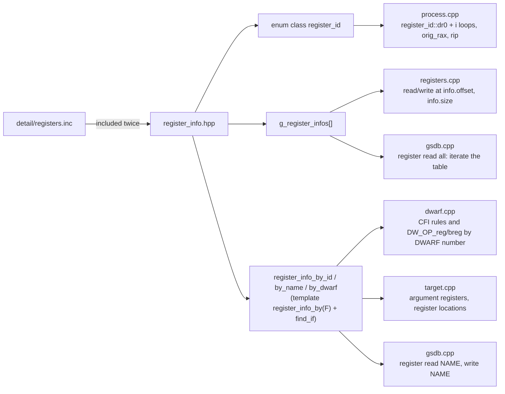

Two contracts are worth knowing:
- **Order.** `process.cpp` computes `static_cast<register_id>(static_cast<int>(register_id::dr0) + i)`
  to walk DR0–DR7. That only works because the `.inc` lists `dr0 … dr7` consecutively,
  and the enum's order *is* the file's order.
- **Offsets are into `struct user`.** `registers` stores exactly one `struct user`
  (`data_`), so `read`/`write` are just "copy `info.size` bytes at `info.offset`". The same
  offsets are what `PTRACE_PEEKUSER`/`POKEUSER` expect, which is why
  `registers::write` can poke `info.offset & ~0b111` directly.

### 7.2 `src/include/syscalls.inc` → syscall names

```
 syscalls.inc                syscalls.cpp, expansion #1                         expansion #2
 DEFINE_SYSCALL(read,0)  ──► {"read", 0},  inside                        ──►   case 0: return "read";  inside
 DEFINE_SYSCALL(write,1)     const unordered_map<string_view,int>               switch (id) in syscall_id_to_name
 …(about 380 lines)          g_syscall_name_map = { … };
```

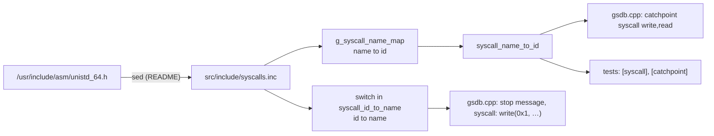

The `.inc` lives in `src/include/` and is a **private** include directory
(`target_include_directories(libgsdb PRIVATE …)`). Only the library sees it, and the public
API is just the two functions in `syscalls.hpp`. `process` never needs names; it works
with numbers from `orig_rax`.

### 7.3 `detail/dwarf.h` → every DWARF constant

- **What it is:** about 480 constants in unnamed `enum { … }` blocks: `DW_TAG_*`, `DW_AT_*`,
  `DW_FORM_*`, `DW_OP_*`, `DW_CFA_*`, `DW_LNS_*`/`DW_LNE_*`, `DW_EH_PE_*`, `DW_ATE_*`,
  `DW_LANG_*`.
- **Why unnamed enums:** the enumerators are plain integer constants. They can be compared
  with values read from the file, switched on, and passed as template arguments. That last
  one is how `type::strip<DW_TAG_const_type, DW_TAG_typedef, …>()` works with its
  `template <int... Tags>` parameter.
- **Who includes it:** `dwarf.hpp`, `type.hpp`, `dwarf.cpp`, `type.cpp`, `target.cpp`,
  `breakpoint.cpp`, `tools/gsdb.cpp` and the tests. Every place that asks "what tag is
  this DIE?" or "does it have `DW_AT_low_pc`?".

## 8. The classes and how they relate

Relationship legend for the class diagrams:
- `*--` means **owns** (destroyed with the owner);
- `o--` means **holds non-owning pointers to**;
- `-->` means **refers to / back-pointer**;
- `<|--` means **inherits from**;
- `..>` means **friend / creates**.

### 8.1 The machine layer

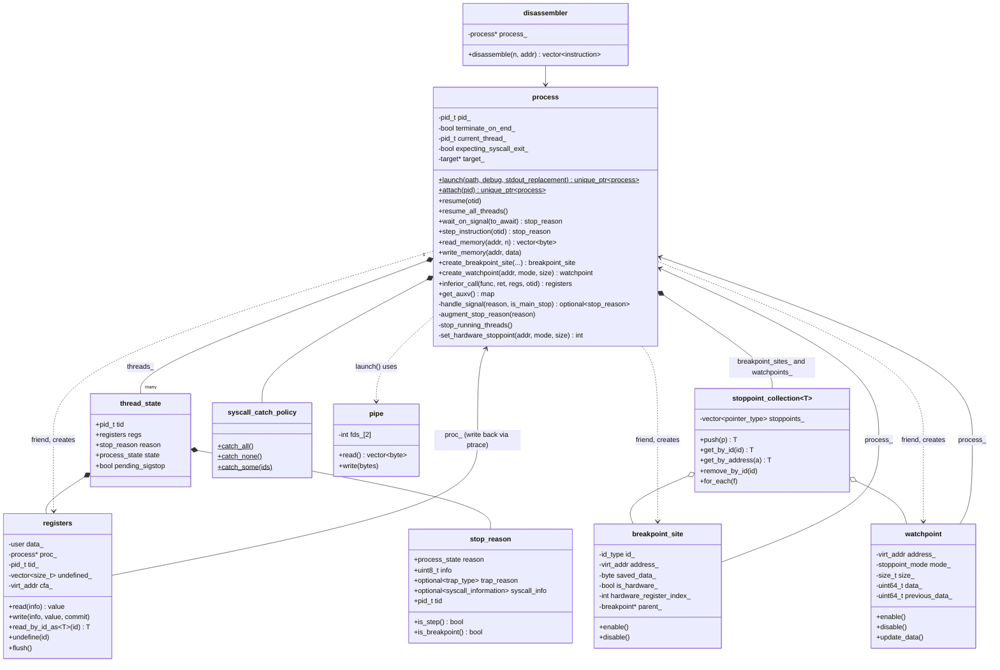

### 8.2 The file layer: ELF and DWARF

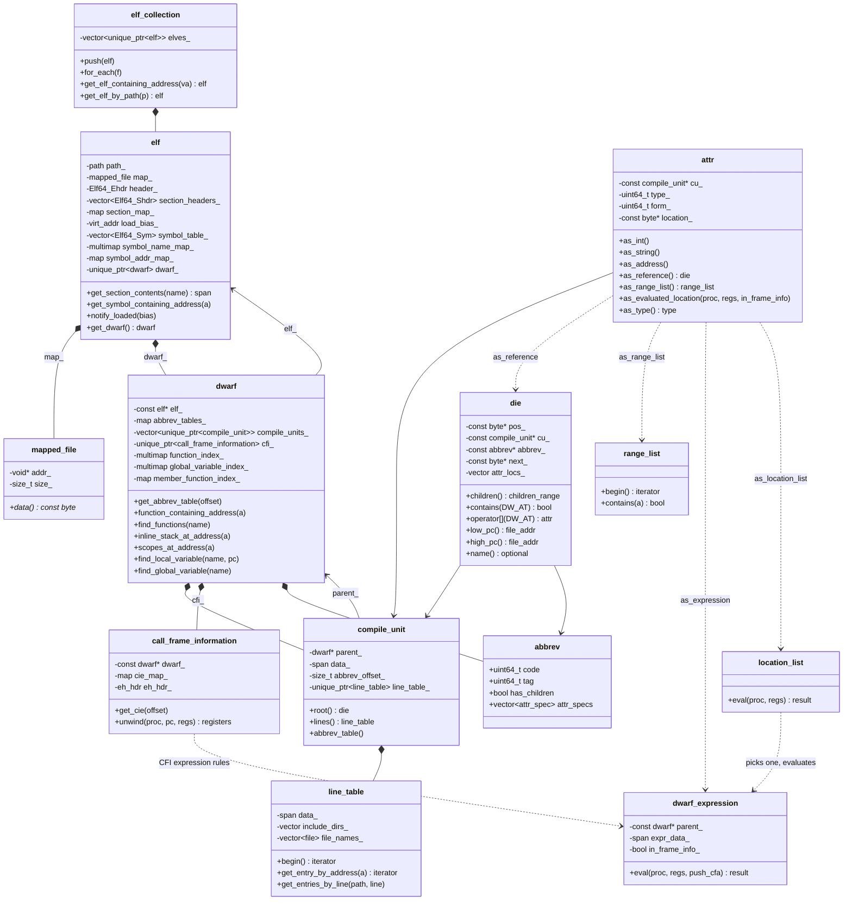

**Who owns the bytes?** Only `mapped_file`. Every other class above holds `span`s or raw
`const std::byte*` pointers into that one mapping. That is why:
- `die`, `attr` and the iterators are cheap to copy (a few pointers);
- they're only valid while their `elf` is alive;
- `elf_collection` keeps every `elf` for the whole session.

### 8.3 The symbolic layer

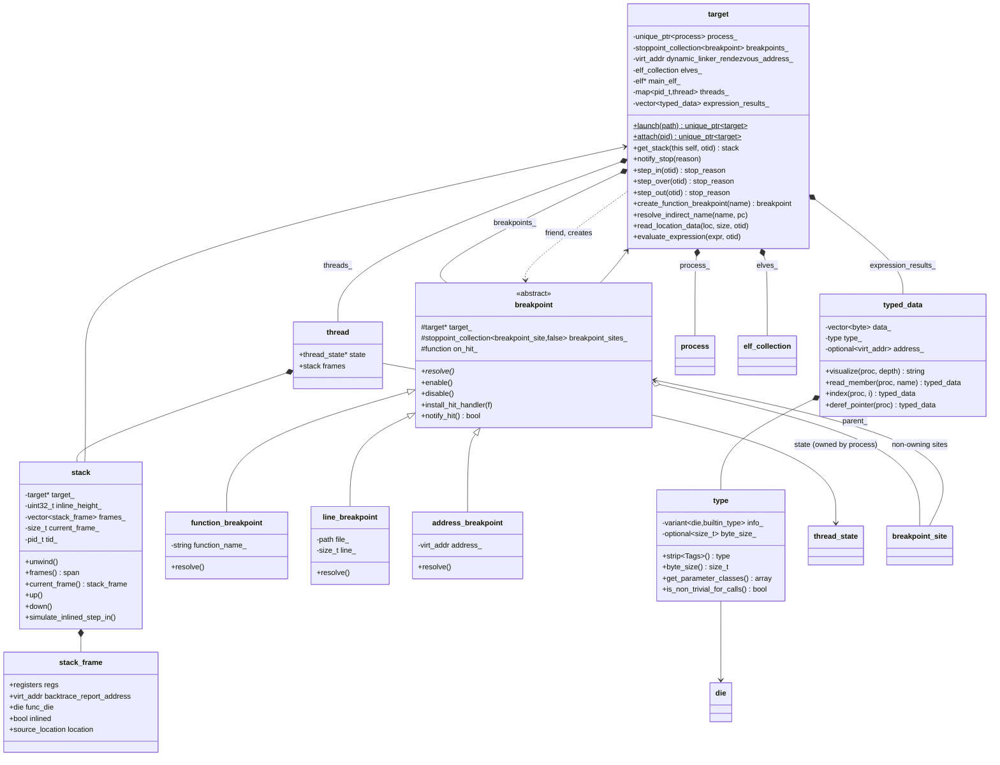

### 8.4 Who creates whom, and why construction is controlled

| Class | Constructor | Created by | Owned by |
|---|---|---|---|
| `process` | private | `process::launch`, `process::attach` | `target` (or a test) through `unique_ptr` |
| `target` | private | `target::launch`, `target::attach` | `main` / test, through `unique_ptr` |
| `registers` | private (`friend process`) | `process` when it adds a `thread_state` | `thread_state` (copied freely into stack frames) |
| `breakpoint_site` | private (`friend process`) | `process::create_breakpoint_site` | `process::breakpoint_sites_` |
| `watchpoint` | private (`friend process`) | `process::create_watchpoint` | `process::watchpoints_` |
| `breakpoint` subclasses | private, `friend target` (base constructor `protected`) | `target::create_*_breakpoint` | `target::breakpoints_` |
| `elf` | public | `create_loaded_elf`, `reload_dynamic_libraries` | `target::elves_` |
| `dwarf` | public, `explicit` | `elf`'s constructor | `elf::dwarf_` |
| `compile_unit` | public | `parse_compile_units` | `dwarf::compile_units_` |
| `line_table` | public | `compile_unit`'s constructor (`parse_line_table`) | `compile_unit::line_table_` |
| `call_frame_information` | public | `parse_call_frame_information` | `dwarf::cfi_` |
| `die`, `attr`, `range_list`, `dwarf_expression`, `location_list`, `type`, `typed_data` | public | anyone, on demand | values: copied around freely; they point into the mapping |

The rule of thumb: **anything that stands for an OS resource or an inferior-side change
(a process, a patched `int3`, a debug-register slot) can only be made by its owner, which
hands out references.** Anything that is a *view of parsed data* is a cheap value type.

## 9. The connective tissue

### 9.1 One template, four containers

`stoppoint_collection<Stoppoint, Owning>` is instantiated four times. The concept
`stoppoint_concept` requires an `id_type`, plus `at_address`, `in_range`, `is_enabled`,
`enable` and `disable`. It's the only thing the three element types have in common;
there's no shared base class.

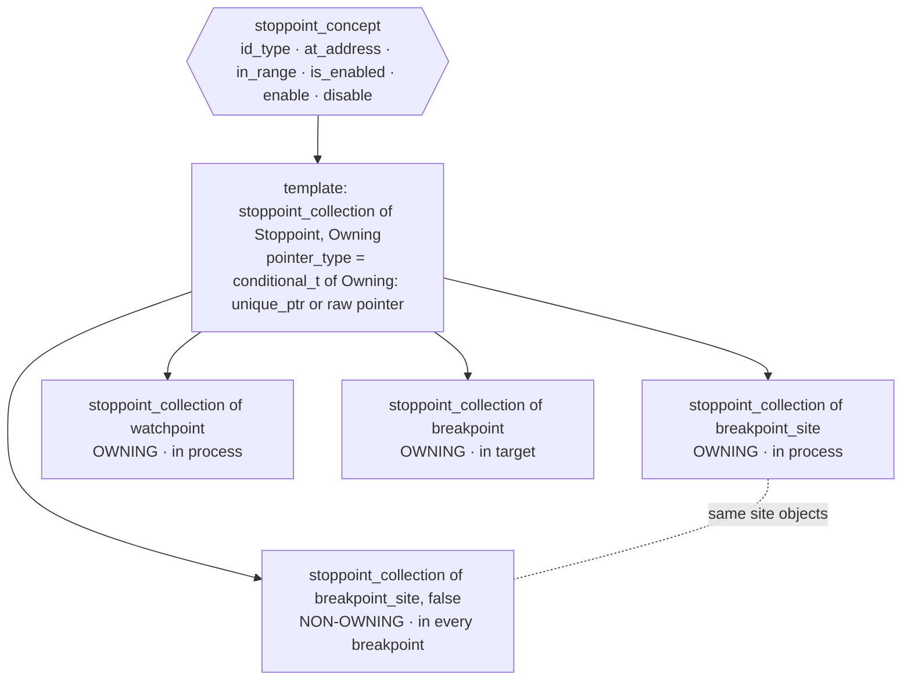

- **How `breakpoint` satisfies the concept.** A logical breakpoint has no single address.
  It answers `at_address(a)` and `in_range(lo, hi)` by asking *its own* site collection.
  That lets `target::breakpoints_.get_by_address(entry_point)` find "the breakpoint that
  owns the site at the entry point".
- **Why two collections share the same sites.**
  - `process` owns every site, so the low-level loop can map a PC to a site without
    knowing about logical breakpoints.
  - Each `breakpoint` keeps non-owning pointers to *its* sites, so `enable`/`disable` and
    `breakpoint list` work per breakpoint.
  - Deleting a breakpoint therefore takes two steps:
    1. remove it from `target::breakpoints_`;
    2. remove its sites, by address, from `process::breakpoint_sites_`.
- **Every `const` method forwards to the non-const one with `const_cast`.**
  `find_by_id`, `get_by_id`, `get_by_address` and friends all do this. It's the classic
  *Effective C++* Item 3 idiom, which keeps one implementation per lookup.

### 9.2 The variants, and who takes them apart

| Variant | Alternatives | Produced by | Consumed by (how) |
|---|---|---|---|
| `registers::value` | 8 integer types, `float`, `double`, `long double`, `byte64`, `byte128` | `registers::read` (switch on format/size); CLI `parse_register_value` | `registers::write` (`std::visit` + `widen`); CLI formatter (`std::visit` + `if constexpr`); `read_location_data` (`std::visit` → bytes); `read_by_id_as<T>` (`std::get`) |
| `dwarf_expression::simple_location` | address, register, data, literal, empty | `dwarf_expression::eval` (`get_current_location`) | `read_location_data` (`get_if` chain); `read_frame_base_result`; `execute_unwind_rules` (`dwexp_addr_result`) |
| `dwarf_expression::result` | `simple_location`, `pieces_result` | `eval`, `location_list::eval`, `as_evaluated_location` | `read_location_data` (pieces → `memcpy_bits`); CLI `variable location` |
| `unwind_context::rule` | undefined, same, offset, val_offset, register, expression, val_expression | `execute_cfi_instruction` | `execute_unwind_rules` (`get_if` chain) |
| `unwind_context::cfa_rule_type` | register+offset, expression | `DW_CFA_def_cfa*` | `execute_unwind_rules` |
| `type::info_` | `die`, `builtin_type` | `attr::as_type`, CLI literal parsing | `get_die`, `get_builtin_type`, `is_from_dwarf` (`holds_alternative`); `operator==` compares across the two |
| hardware stoppoint id | `breakpoint_site::id_type`, `watchpoint::id_type` | `process::get_current_hardware_stoppoint` (`in_place_index<0/1>`) | `handle_signal` (`index() == 1` → update watchpoint); CLI `get_sigtrap_info` |

The pattern: **a closed set of possibilities is a `variant`. The producer sets exactly one
alternative, and the consumer dispatches with `std::visit` or `get_if`**, never with a
type tag plus casts.

### 9.3 Calls that go *up* the layers

Most calls go down: CLI → `target` → `process` → kernel. A few have to go **up**, because
the lower layer notices something the upper layer must react to. Each goes through a
pointer or a callback the upper layer installed:

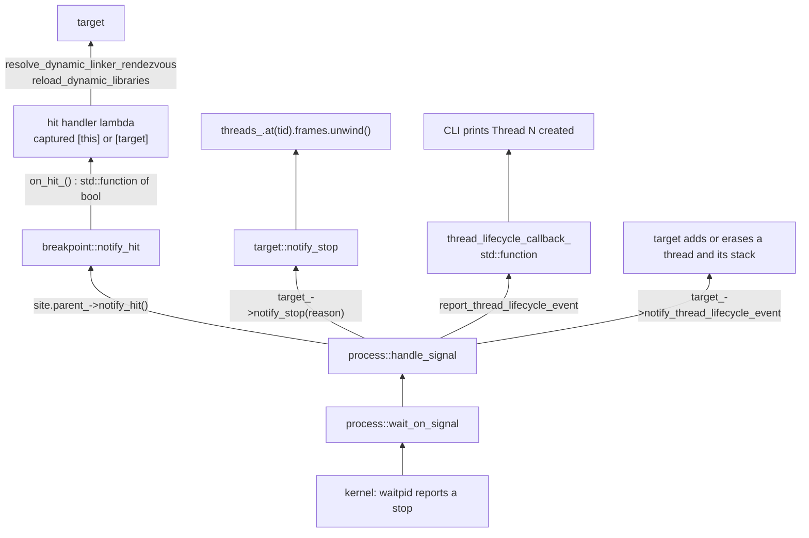

| Upward link | Installed by | Used for |
|---|---|---|
| `process::target_` (raw pointer) | `target::launch/attach` calls `set_target(tgt.get())` | recompute stacks on every stop; keep `target::threads_` in sync with `process::threads_` |
| `breakpoint_site::parent_` | `breakpoint::resolve` passes `this` to `create_breakpoint_site` | `handle_signal` → `parent_->notify_hit()` |
| `breakpoint::on_hit_` (`std::function<bool()>`) | `install_hit_handler` | internal breakpoints that do work and auto-resume (`true`), or stop (`false`) |
| `process::thread_lifecycle_callback_` | the CLI's `main` | print "Thread N created/exited" |
| `stack::target_` | `target` constructor / `notify_thread_lifecycle_event` | the stack asks the target for the PC as a file address, the ELF list and the process |
| `breakpoint::target_` | the `breakpoint` constructor | `resolve()` asks the target to find functions/lines and create sites |

`~process` sets `target_ = nullptr` and clears the callback before tearing down. That's a
small but important detail: the `target` is mid-destruction around it, so calling up would
reach a half-destroyed object.

### 9.4 "Which thread?": the `std::optional<pid_t> otid` thread

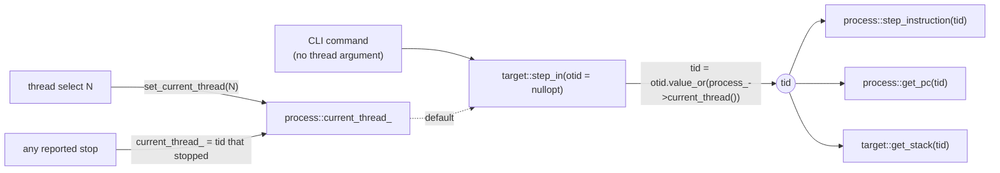

About two dozen functions take `std::optional<pid_t> otid = std::nullopt` and start with
`auto tid = otid.value_or(current_thread_)`. That's how one API serves both "the current
thread" (the CLI) and "this specific thread" (`stop_running_threads`, the tests, every
nested call that has to stay on one thread).

### 9.5 How errors travel

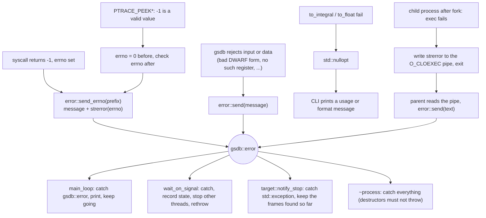

### 9.6 Lazy caches and `mutable`

Several `const` lookups do expensive work the first time and remember the result. The
cache members are `mutable`, so "logically const" methods can fill them:

| Cache | Filled by | First triggered by |
|---|---|---|
| `dwarf::abbrev_tables_` (offset → table) | `get_abbrev_table` (non-const; `compile_unit` keeps a non-const `dwarf*` for this) | parsing the first DIE of a compile unit |
| `dwarf::function_index_`, `global_variable_index_`, `member_function_index_` | `index()` → `index_die()` recursion over every DIE | the first function, global or member lookup |
| `call_frame_information::cie_map_` | `get_cie` | the first FDE that references a CIE |
| `type::byte_size_` | `byte_size()` → `compute_byte_size()` | the first size query |
| `line_table::file_names_` | `DW_LNE_define_file` during iteration | a line program that defines files |
| `target::expression_results_` | `evaluate_expression`, refreshed in `get_expression_result` | each `expression` command |

## 10. Data pipelines: from bytes to meaning

### 10.1 From the file on disk to DWARF objects

```mermaid
flowchart LR
    file[("ELF file on disk")] -->|"open, fstat, mmap"| mf["mapped_file<br/>const byte*"]
    mf --> ehdr["Elf64_Ehdr header_"]
    ehdr -->|"e_shoff, e_shnum"| shdrs["section_headers_"]
    shdrs -->|"names from .shstrtab"| smap["section_map_"]
    smap -->|"get_section_contents(name): span"| spans{{"spans into the mapping"}}
    spans -->|".symtab/.dynsym + .strtab"| syms["symbol_table_<br/>symbol_name_map_, symbol_addr_map_"]
    spans -->|".debug_info"| cus["parse_compile_units<br/>compile_unit per CU"]
    spans -->|".debug_abbrev"| abbr["parse_abbrev_table<br/>cached by offset"]
    spans -->|".debug_line"| lt["parse_line_table<br/>line_table per CU"]
    spans -->|".debug_str"| strp["attr::as_string (strp)"]
    spans -->|".debug_ranges"| rl["attr::as_range_list"]
    spans -->|".debug_loc"| ll["attr::as_location_list"]
    spans -->|".eh_frame_hdr, .eh_frame"| cfi["call_frame_information"]
```

### 10.2 Inside `.debug_info`: the cursor, the abbreviation, the DIE

```mermaid
flowchart LR
    cuspan["compile_unit data_ (span)"] -->|"skip 11-byte header"| cur1["cursor"]
    cur1 -->|"uleb128: abbrev code"| code(("code"))
    code -->|"cu.abbrev_table().at(code)"| ab["abbrev: tag, has_children, attr_specs"]
    ab -->|"for each spec: remember position, skip_form(form)"| locs["attr_locs_ vector"]
    locs --> d["die: pos, cu, abbrev, next, attr_locs"]
    d -->|"die[DW_AT_x] finds spec index i"| a["attr: cu, name, form, attr_locs_[i]"]
    a -->|"as_int, as_string, as_address ..."| v["value"]
    a -->|"as_reference: CU offset or .debug_info offset"| d2["another die"]
    d -->|"children(): iterator parses next_"| kids["child dies, lazily"]
```

`cursor` (an anonymous-namespace class in `dwarf.cpp`) is the one reader used by **every**
DWARF parser in that file:
- CU headers and DIEs;
- attribute decoding;
- abbreviation tables;
- the line-table header and program;
- range lists and location lists;
- CIEs, FDEs and the `.eh_frame_hdr` search;
- CFI instructions;
- DWARF expressions.

It wraps a `span` and knows fixed-width integers (through `from_bytes`), C strings,
ULEB/SLEB128 and `skip_form`. Everything else is built on those five operations.

### 10.3 The line table: program → rows → answers

```mermaid
flowchart LR
    cu["compile_unit ctor"] -->|"DW_AT_stmt_list offset"| hdr["parse_line_table: header, dirs, files"]
    hdr --> lt["line_table (program span + header fields)"]
    lt -->|"begin()"| it["line_table::iterator"]
    it -->|"operator++ runs execute_instruction until a row is emitted"| row["entry: address, file, line, is_stmt, end_sequence ..."]
    row --> q1["get_entry_by_address(pc)<br/>stop messages, step_in/over termination, backtrace lines"]
    row --> q2["get_entries_by_line(file, line)<br/>line_breakpoint::resolve"]
    row --> q3["++ after a function's first row<br/>prologue skipping"]
```

### 10.4 Reading a variable: name → bytes → text

```mermaid
flowchart TD
    name["'me.pets[0].name'"] --> rin["target::resolve_indirect_name"]
    rin --> giv["get_initial_variable_data('me')"]
    giv --> fv["find_variable: scopes_at_address, then global indexes"]
    fv --> die["variable DIE"]
    die -->|"DW_AT_type"| ty["type"]
    die -->|"DW_AT_location + selected frame's registers"| ev["as_evaluated_location → dwarf_expression::eval"]
    ev -->|"DW_OP_addr / DW_OP_fbreg"| loc["simple_location: address"]
    loc --> rld["target::read_location_data(loc, byte_size)"]
    rld -->|"process::read_memory"| bytes["bytes"]
    bytes --> td["typed_data{bytes, type, address}"]
    td -->|".pets"| rm["read_member: slice at DW_AT_data_member_location"]
    rm -->|"[0]"| ix["index: pointer → read_memory(address + 0 * size)"]
    ix -->|".name"| rm2["read_member"]
    rm2 --> vis["visualize: char pointer → read_string → quoted text"]
```

A cross-component dependency is hiding in this picture. GCC's frame base for a function
is `DW_OP_call_frame_cfa`, and `DW_OP_fbreg` locals are addressed relative to it. The value
comes from `registers::cfa()`, which **`stack::unwind` stores** into each frame's register
set while running the CFI rules (`execute_unwind_rules` calls `old_regs.set_cfa(cfa)`). So
reading a local variable depends on unwinding having already run for that stop. It always
has: `notify_stop` unwinds on every stop.

### 10.5 Unwinding: PC → caller's registers

```mermaid
flowchart LR
    pc["file_addr pc"] -->|"eh_hdr_[pc]: binary search"| fdeptr["FDE pointer"]
    fdeptr -->|"parse_fde"| fde["FDE: initial_location, range, instructions"]
    fde -->|"CIE pointer → get_cie (cached)"| cie["CIE: alignment factors, RA column, initial instructions"]
    cie -->|"execute all CIE instructions"| rules0["cie_register_rules"]
    fde -->|"execute FDE instructions while location ≤ pc"| rules["unwind_context: cfa_rule + register_rules"]
    rules0 --> rules
    rules -->|"execute_unwind_rules(ctx, frame regs, process)"| out["caller's registers<br/>rsp = CFA, rip = rule for column 16"]
    out --> next["next frame: pc = rip - 1"]
```

### 10.6 Registers: kernel ↔ bytes ↔ typed values

```mermaid
flowchart LR
    k["kernel: thread's saved state"] -->|"PTRACE_GETREGS, GETFPREGS, PEEKUSER dr0-7"| data["registers::data_ (struct user)"]
    data -->|"read(info): from_bytes at info.offset"| val["registers::value (variant)"]
    val -->|"std::visit format"| cli["CLI: rax: 0x000000000000002a"]
    txt["CLI text '0x2a'"] -->|"parse_register_value"| val2["value"]
    val2 -->|"write(info, v): visit + widen, copy info.size bytes"| data
    data -->|"commit: POKEUSER at offset and ~7, or SETFPREGS"| k
    data -->|"copied into stack frames"| fr["stack_frame.regs"]
    fr -->|"CFI rules rewrite rsp, rip, callee-saved"| fr2["caller frame regs"]
```

## 11. Every operation, traced through the code

Each diagram follows the real call chain. The function names are the ones in the source.

### 11.1 `gsdb ./prog`: launch

```mermaid
sequenceDiagram
    autonumber
    participant CLI as gsdb.cpp main
    participant T as target
    participant P as process
    participant K as kernel
    participant C as child
    CLI->>T: target::launch(path)
    T->>P: process::launch(path, debug=true)
    P->>P: pipe channel(close_on_exec=true)
    P->>K: fork()
    K-->>C: child starts
    C->>K: setpgid(0,0), personality(ADDR_NO_RANDOMIZE)
    C->>K: ptrace(PTRACE_TRACEME)
    C->>K: execlp(path)
    K-->>C: new image, stopped by SIGTRAP before the first instruction
    P->>P: channel.read() returns empty: exec succeeded
    P->>P: new process(pid, terminate_on_end=true) reads /proc/pid/task
    P->>K: wait_on_signal: waitpid
    P->>K: PTRACE_SETOPTIONS TRACESYSGOOD, TRACECLONE, EXITKILL
    T->>T: create_loaded_elf: elf(path) then notify_loaded(AT_ENTRY - e_entry)
    T->>T: new target(proc, elf): elves_.push, one thread + stack per tid
    T->>P: set_target(this)
    T->>T: create_address_breakpoint(AT_ENTRY, internal) + hit handler
    T->>P: resolve() → create_breakpoint_site, enable → POKEDATA 0xcc
    T-->>CLI: unique_ptr of target
    CLI->>P: install_thread_lifecycle_callback, signal(SIGINT, handle_sigint)
```

### 11.2 `continue` until a breakpoint

```mermaid
sequenceDiagram
    autonumber
    participant CLI
    participant P as process
    participant K as kernel
    participant BP as breakpoint
    participant T as target
    participant S as stack
    CLI->>P: resume_all_threads()
    loop every thread
        P->>P: step_over_breakpoint(tid): disable, SINGLESTEP, waitpid, enable
    end
    loop every thread
        P->>K: send_continue: PTRACE_CONT (or PTRACE_SYSCALL)
    end
    CLI->>P: wait_on_signal()
    K-->>P: waitpid: tid stopped with SIGTRAP
    P->>P: handle_signal(reason, main stop)
    P->>K: read_all_registers: GETREGS, GETFPREGS, PEEKUSER dr0-7
    P->>K: augment_stop_reason: GETSIGINFO, si_code SI_KERNEL means software break
    P->>P: pc-1 is an enabled site, so set_pc(pc-1)
    P->>BP: site.parent_->notify_hit()
    BP-->>P: false (a user breakpoint has no handler)
    P->>T: notify_stop(reason)
    T->>S: frames.unwind(): inline stack, CFI, frames_
    P->>P: stop_running_threads(): tgkill SIGSTOP + waitpid each running thread
    P->>P: cleanup_exited_threads, current_thread_ = tid
    P-->>CLI: stop_reason
    CLI->>CLI: handle_stop: print_stop_reason, print_code_location
```

### 11.3 Stepping over the original instruction

The same logic backs both `resume` and `step_instruction`, because a site at the current
PC would otherwise trap immediately:

```mermaid
sequenceDiagram
    participant P as process
    participant Site as breakpoint_site
    participant K as kernel
    P->>Site: enabled site at pc? disable()
    Site->>K: POKEDATA original byte back
    P->>P: swallow_pending_sigstop(tid)
    P->>K: PTRACE_SINGLESTEP
    K-->>P: SIGTRAP, TRAP_TRACE
    P->>Site: enable()
    Site->>K: POKEDATA 0xcc again
    P->>K: PTRACE_CONT (resume) or report the step (step_instruction)
```

### 11.4 The entry-point breakpoint loads the shared libraries

```mermaid
sequenceDiagram
    autonumber
    participant K as kernel and ld.so
    participant P as process
    participant BP as entry breakpoint
    participant T as target
    participant E as elf_collection
    K-->>P: SIGTRAP at AT_ENTRY (ld.so finished loading)
    P->>BP: notify_hit()
    BP->>T: hit handler: resolve_dynamic_linker_rendezvous()
    T->>P: read_memory(.dynamic of the main ELF)
    T->>T: find DT_DEBUG, the address of r_debug
    T->>T: reload_dynamic_libraries()
    loop each link_map in r_debug.r_map
        T->>P: read_memory_as link_map, read the l_name string
        alt vDSO
            T->>T: dump_vdso to /tmp/gsdb-XXXXXX
        end
        T->>E: push(new elf(name)), notify_loaded(l_addr)
        T->>T: breakpoints_.for_each(resolve)
    end
    T->>T: create_address_breakpoint(r_brk = _dl_debug_state, internal)
    BP-->>P: handler returns true
    P->>P: handle_signal returns nullopt, so resume(tid) and wait again
```

### 11.5 `step` (step in)

```mermaid
sequenceDiagram
    autonumber
    participant CLI
    participant T as target
    participant S as stack
    participant P as process
    participant D as dwarf / line_table
    CLI->>T: step_in()
    alt inline_height above 0
        T->>S: simulate_inlined_step_in(): inline_height_ minus 1
        T-->>CLI: synthesized single_step stop
    else
        T->>D: line_entry_at_pc(): orig_line
        loop until the line differs and is not end_sequence
            T->>P: step_instruction(tid)
            P-->>T: stop (unwound by notify_stop)
        end
        T->>D: function_containing_address(pc)
        opt pc is the function's low_pc: we entered a new function
            T->>D: line entry at pc, ++ for the first row after the prologue
            T->>T: run_until_address(that row): temp internal site, resume, wait, remove
        end
        T-->>CLI: stop_reason
    end
```

### 11.6 `next` (step over) and `finish` (step out)

```mermaid
flowchart TD
    start(["step_over"]) --> loop{{"repeat"}}
    loop --> q1{"inline_height above 0?"}
    q1 -- yes --> a1["run_until_address(high_pc of the inlined frame being skipped)"]
    q1 -- no --> q2{"disassemble 2 instructions:<br/>does the first start with call?"}
    q2 -- yes --> a2["run_until_address(address of the second instruction)"]
    q2 -- no --> a3["process::step_instruction"]
    a1 --> chk
    a2 --> chk
    a3 --> chk{"stopped for another reason?<br/>(breakpoint, exit)"}
    chk -- yes --> report(["report that stop"])
    chk -- no --> line{"line entry still the original,<br/>or end_sequence?"}
    line -- yes --> loop
    line -- no --> done(["report single step"])
```

```mermaid
flowchart TD
    s(["step_out"]) --> q{"inside an inlined frame?<br/>inline stack size above 1 and<br/>inline_height below size minus 1"}
    q -- yes --> a["return address = high_pc of the current inlined function"]
    q -- no --> b["return address = rip of the caller frame<br/>stack.frames()[current + 1].regs"]
    a --> r["run_until_address(return address)"]
    b --> r
    r --> done(["report stop"])
```

### 11.7 `variable read x`

```mermaid
sequenceDiagram
    autonumber
    participant CLI
    participant T as target
    participant D as dwarf
    participant X as dwarf_expression
    participant P as process
    participant V as typed_data
    CLI->>T: resolve_indirect_name("x", pc file address)
    T->>D: find_local_variable: scopes_at_address(pc)
    D-->>T: variable DIE (else global index of every ELF)
    T->>X: DIE[DW_AT_location].as_evaluated_location(proc, selected frame regs)
    X->>X: DW_OP_fbreg: evaluate function's DW_AT_frame_base (call_frame_cfa)
    X-->>T: address_result
    T->>P: read_location_data → read_memory(address, byte_size)
    T-->>CLI: typed_data{bytes, type, address}
    CLI->>V: visualize(proc)
    V-->>CLI: "42"
```

### 11.8 `expression f(1, "hi")`: calling a function inside the debuggee

```mermaid
sequenceDiagram
    autonumber
    participant CLI
    participant T as target
    participant TY as type
    participant P as process
    participant K as inferior CPU
    CLI->>T: evaluate_expression(f(1, 'hi'))
    T->>T: resolve_indirect_name("f(") → candidate function DIEs
    T->>T: collect_arguments → parse_argument for each
    T->>T: "hi": inferior_malloc(3) is itself an inferior call to libc malloc
    T->>P: write_memory(heap pointer, "hi" + NUL)
    T->>TY: resolve_overload: parameter_types() == argument types
    T->>T: inferior_malloc(return size) = return slot
    T->>TY: setup_arguments: get_parameter_classes per argument
    T->>P: write rdi, rsi, xmm0..., stack args, rax = SSE count, rsp aligned
    T->>P: inferior_call(func, return address = AT_ENTRY, saved regs)
    P->>P: rip = func, push AT_ENTRY, resume
    K->>K: f runs, returns into the entry-point int3
    P->>P: wait_on_signal: entry breakpoint, handler returns false so it stops
    P->>P: capture regs, restore saved regs, flush
    T->>T: read_return_value: rax/rdx, xmm0/xmm1, st0, or the return slot
    T->>T: expression_results_.push_back → $N
    T-->>CLI: $0: value
```

### 11.9 A new thread appears

```mermaid
sequenceDiagram
    autonumber
    participant A as thread A (inferior)
    participant K as kernel
    participant P as process
    participant T as target
    participant CLI
    A->>K: clone()
    K-->>P: A stops: wait status carries SIGTRAP plus the PTRACE_EVENT_CLONE event
    P->>P: handle_signal: trap_type::clone, main stop → nullopt
    P->>K: resume(A)
    K-->>P: new thread B auto-attached, stopped with SIGSTOP
    P->>P: handle_signal: unknown tid → threads_.emplace(B, thread_state)
    P->>CLI: thread_lifecycle_callback: "Thread B created"
    P->>T: notify_thread_lifecycle_event: threads_.emplace(B, thread{state, stack})
    P->>K: nullopt → resume(B), keep waiting
```

### 11.10 A syscall catchpoint stop

```mermaid
sequenceDiagram
    participant CLI
    participant P as process
    participant K as kernel
    CLI->>P: set_syscall_catch_policy(catch_some({write}))
    CLI->>P: resume_all_threads → send_continue uses PTRACE_SYSCALL
    K-->>P: stop with SIGTRAP plus bit 0x80 (TRACESYSGOOD)
    P->>P: augment_stop_reason: entry or exit? (expecting_syscall_exit_)
    P->>P: id from orig_rax, args from rdi rsi rdx r10 r8 r9, or ret from rax
    alt id not in the policy
        P->>P: should_resume_from_syscall → nullopt → resume and wait again
    else id is caught
        P-->>CLI: stop_reason with syscall_info
        CLI->>CLI: get_sigtrap_info: syscall_id_to_name + format_join(args)
    end
```

### 11.11 A watchpoint fires

```mermaid
sequenceDiagram
    participant CLI
    participant P as process
    participant W as watchpoint
    participant K as kernel and CPU
    CLI->>P: create_watchpoint(addr, read_write, 4)
    P->>W: constructor: validate size and alignment, update_data()
    CLI->>W: enable()
    W->>P: set_watchpoint → set_hardware_stoppoint
    P->>K: write DRn = addr, DR7 enable + mode + size, for every thread
    K-->>P: SIGTRAP TRAP_HWBKPT after the access
    P->>P: get_current_hardware_stoppoint: DR6 ctz → slot → address → variant index 1
    P->>W: update_data(): previous_data_ = exchange(data_, new value)
    P-->>CLI: stop
    CLI->>CLI: get_sigtrap_info: Value or Old/New value
```

### 11.12 Ctrl-C, and shutting down

```mermaid
sequenceDiagram
    participant U as user
    participant TTY as terminal
    participant G as gsdb
    participant I as inferior (own process group)
    U->>TTY: Ctrl-C
    TTY->>G: SIGINT (foreground group only)
    G->>I: handle_sigint: kill(pid, SIGSTOP)
    I-->>G: waitpid in wait_on_signal returns: stopped, SIGSTOP
    G->>G: stop_running_threads, print "stopped with signal STOP"
```

Destruction runs in reverse member order. `target`'s members are declared `process_`,
`breakpoints_`, rendezvous address, `elves_`, `main_elf_`, `threads_`,
`expression_results_`. So:

```mermaid
flowchart LR
    a["expression_results_"] --> b["threads_ (stacks, frame registers)"] --> c["elves_: each elf → dwarf_ → compile units → mapped_file munmap"] --> d["breakpoints_ (logical, non-owning views of sites)"] --> e["process_: ~process kills and reaps (launched) or removes int3 bytes and detaches (attached); then its sites and watchpoints"]
```

`process_` is destroyed **last**. So the inferior is still under control while everything
that might reference it goes away, and the breakpoint sites (owned by `process`) outlive
the logical breakpoints that point at them.

## 12. The CLI layer

`tools/gsdb.cpp` is a thin layer. It parses text, calls exactly one or two library
functions, and formats the result. Prefix matching runs in a fixed order, which is why
`s` means `step` and `ca` is needed for `catchpoint`.

```mermaid
flowchart LR
    rl["main_loop: readline('gsdb> ')<br/>empty line repeats history"] --> hc["handle_command: split on spaces"]
    hc -->|continue| c1["process::resume_all_threads + wait_on_signal → handle_stop"]
    hc -->|register| c2["handle_register_command → stack.regs() read / registers::write"]
    hc -->|breakpoint| c3["target::create_*_breakpoint, breakpoints().get_by_id, enable/disable/remove"]
    hc -->|"next / finish / step"| c4["target::step_over / step_out / step_in → handle_stop"]
    hc -->|stepi| c5["process::step_instruction → handle_stop"]
    hc -->|memory| c6["process::read_memory / write_memory + format_join"]
    hc -->|disassemble| c7["disassembler::disassemble"]
    hc -->|watchpoint| c8["process::create_watchpoint, watchpoints()"]
    hc -->|catchpoint| c9["syscall_name_to_id → process::set_syscall_catch_policy"]
    hc -->|"up / down"| c10["stack::up / down → print_code_location"]
    hc -->|backtrace| c11["stack.frames() + function_name_at_address"]
    hc -->|thread| c12["target.threads(), process::set_current_thread"]
    hc -->|variable| c13["resolve_indirect_name / scopes_at_address / as_evaluated_location → visualize"]
    hc -->|expression| c14["target::evaluate_expression → visualize, $N"]
```

How a stop is printed (`handle_stop`):

```mermaid
flowchart TD
    hs["handle_stop(target, reason)"] --> psr["print_stop_reason"]
    psr -->|exited / terminated| ex["Process N exited with status S"]
    psr -->|stopped| gsr["get_signal_stop_reason: sigabbrev_np, line_entry_at_pc → file:line, function_name_at_address"]
    gsr -->|SIGTRAP| gti["get_sigtrap_info: breakpoint site id, watchpoint values, single step, syscall entry/exit"]
    hs -->|stopped| pcl["print_code_location"]
    pcl -->|stack has frames| src["print_source(file, line, 3) with > marker"]
    pcl -->|no frames| dis["print_disassembly(pc, 5)"]
```

## 13. The tests and the programs they debug

```mermaid
pie showData
    title Test cases by tag (37)
    "[breakpoint]" : 10
    "[process]" : 6
    "[dwarf]" : 6
    "[variable]" : 4
    "[register]" : 2
    "[watchpoint] [catchpoint] [syscall] [memory] [elf] [target] [unwind] [dynlib] [threads]" : 9
```

| Tag | Layer exercised | Target program(s) | Technique |
|---|---|---|---|
| `[process]` | `process` launch/attach/resume | `run_endlessly`, `end_immediately`, `sleep` | check `/proc/<pid>/stat` state letters (`t`, `R`, `S`) |
| `[register]` | `registers`, ptrace register I/O | `reg_write.s`, `reg_read.s` | assembly sets exact values, then traps with `kill(getpid(), SIGTRAP)`; the write test checks `printf` output through a pipe |
| `[breakpoint]` | `breakpoint_site`, `stoppoint_collection`, hardware breakpoints, source breakpoints | `run_endlessly`, `hello_gsdb`, `anti_debugger`, `overloaded` | ids, lookup, iteration, address breakpoint at `_start` (located through `readelf` + `/proc/<pid>/maps`), checksum evasion |
| `[memory]` | `read_memory`, `write_memory` | `memory` | the target writes pointers to the pipe; the test reads and writes through them |
| `[watchpoint]` | debug registers in read/write mode | `anti_debugger` | watchpoint → step → software breakpoint |
| `[syscall]`, `[catchpoint]` | `syscalls.inc`, `PTRACE_SYSCALL` | `anti_debugger` | catch `write` entry and exit |
| `[elf]` | `elf` symbols and load bias | `hello_gsdb` | `_start` by address, by name, and after `notify_loaded(0xcafecafe)` |
| `[dwarf]` | DIEs, ranges, line tables, expressions | `hello_gsdb`, `step` | hand-built `.debug_ranges` bytes and `DW_OP_piece` programs |
| `[target]` | stepping and inline height | `step` | `always_inline` functions nested two deep |
| `[unwind]` | CFI and inline frames | `step` | expected frame names innermost → outermost |
| `[dynlib]` | rendezvous and multi-ELF | `marshmallow` + `libmeow.so` | breakpoint in the library; two frames across two ELFs |
| `[threads]` | clone events, all-stop | `multi_threaded` | ten threads must each hit `say_hi` |
| `[variable]` | locations, types, members, scopes | `global_variable`, `blocks`, `member_pointer` | `me.pets[0].name`, bitfields, shadowed `i`, member pointers |

How a test talks to its target:

```mermaid
sequenceDiagram
    participant Test as tests.cpp
    participant Pipe as gsdb::pipe
    participant Proc as process
    participant Tgt as target program
    Test->>Pipe: pipe channel(close_on_exec=false)
    Test->>Proc: process::launch(path, true, channel.get_write())
    Proc->>Tgt: dup2(write end, STDOUT), exec
    Test->>Pipe: close_write() in the parent
    Test->>Proc: resume + wait_on_signal
    Tgt->>Pipe: write(&variable, 8 bytes) to stdout
    Tgt->>Tgt: raise(SIGTRAP) or the trap macro
    Proc-->>Test: stopped
    Test->>Pipe: read() → an address in the inferior
    Test->>Proc: read_memory / write_memory / create_breakpoint_site at it
```

---

# Part III — How a debugger works, and how gsdb does it

## 14. Controlling a process: `ptrace`, `waitpid`, signals

### 14.1 The model

A debugger is just a process with permission to:
- freeze another process;
- inspect and change its registers and memory;
- resume it.

On Linux all of that goes through one system call, **`ptrace`**, plus **`waitpid`** to
learn when the tracee has stopped.

```
        gsdb (tracer)                                kernel                      inferior (tracee)
        ─────────────                                ──────                      ─────────────────
  ptrace(PTRACE_CONT, tid, 0, 0) ───────────────▶  mark runnable  ───────────▶  runs …
                                                                                 int3 / signal / syscall
                                                  ◀── tracee enters a ptrace-stop instead of
                                                      handling the event itself
  waitpid(-1, &status, __WALL) ◀── returns tid ──  status encodes why
  ptrace(PTRACE_GETREGS …), PEEKDATA …             (tracee frozen; tracer reads/writes freely)
  ptrace(PTRACE_CONT …) ─────────────────────────▶ …
```

The kernel side of a breakpoint, from `linux_signals_and_interrupts.md`:
1. `int3` is a CPU exception (#BP, vector 3).
2. Linux's handler queues a `SIGTRAP` for the thread.
3. On the way back to user mode, the kernel notices the thread is traced. Instead of
   delivering the signal, it puts the thread into a **signal-delivery-stop** and wakes the
   tracer's `waitpid`.
4. The signal is only delivered if the tracer passes it back on the next `PTRACE_CONT`.

### 14.2 The kinds of ptrace-stop gsdb handles

| Stop | How it is produced | How gsdb recognizes it |
|---|---|---|
| exec stop | `PTRACE_TRACEME` then `execve`: the kernel sends `SIGTRAP` before the first instruction | the first `wait_on_signal()` in `process::launch` |
| attach stop | `PTRACE_ATTACH` sends `SIGSTOP` | the first `wait_on_signal()` in `process::attach` |
| breakpoint | `int3` → `SIGTRAP`, `si_code == SI_KERNEL` | `augment_stop_reason`: `trap_type::software_break` |
| single step | `PTRACE_SINGLESTEP` sets the trap flag → `SIGTRAP`, `si_code == TRAP_TRACE` | `trap_type::single_step` |
| hardware break/watch | debug-register hit → `SIGTRAP`, `si_code == TRAP_HWBKPT` | `trap_type::hardware_break`, then DR6 says which slot |
| syscall stop | `PTRACE_SYSCALL` → stop at entry and exit, reported as `SIGTRAP \| 0x80` thanks to `PTRACE_O_TRACESYSGOOD` | `trap_type::syscall` |
| clone event | `PTRACE_O_TRACECLONE`: the parent thread stops with `status >> 8 == SIGTRAP \| (PTRACE_EVENT_CLONE << 8)`; the new thread starts with a `SIGSTOP` | `trap_type::clone` in `stop_reason(tid, status)` |
| exit / kill | `WIFEXITED` / `WIFSIGNALED` | `process_state::exited` / `terminated` |

`augment_stop_reason` (in `src/process.cpp`) is where a raw "stopped with SIGTRAP" becomes
one of these. It calls `PTRACE_GETSIGINFO` and switches on `siginfo_t::si_code`.
- x86-64 reports `int3` as `SI_KERNEL`, not `TRAP_BRKPT`. This is a classic surprise.
- Syscall stops are detected first, by the `| 0x80` bit, before `si_code` is consulted.

A traced thread moves between these states:

```mermaid
stateDiagram-v2
    [*] --> Stopped: exec stop or attach stop
    Stopped --> Running: PTRACE_CONT or PTRACE_SYSCALL
    Stopped --> Stepping: PTRACE_SINGLESTEP
    Stepping --> Stopped: TRAP_TRACE
    Running --> Stopped: int3, debug register hit, syscall, clone, signal
    Running --> Exited: exit
    Running --> Killed: fatal signal
    Stopped --> Detached: PTRACE_DETACH
    Exited --> [*]
    Killed --> [*]
    Detached --> [*]
```

And this is how the reason is packed into the `int` that `waitpid` fills in. The `stop_reason(tid, status)`
constructor decodes it:

```
 waitpid status word
   bits 23 … 16       bits 15 … 8          bit 7    bits 6 … 0
 ┌────────────────┬────────────────────┬────────┬────────────┐
 │ PTRACE_EVENT_* │ stop signal        │  core  │   0x7f     │  stopped:  WIFSTOPPED, WSTOPSIG = (status >> 8) & 0xff
 │ (CLONE = 3)    │ SIGTRAP = 5, or    │        │            │            syscall stop: WSTOPSIG == SIGTRAP | 0x80
 │                │ SIGTRAP | 0x80     │        │            │            clone event:  status >> 8 == SIGTRAP | (3 << 8)
 ├────────────────┼────────────────────┼────────┼────────────┤
 │       0        │ exit code          │   0    │     0      │  exited:   WIFEXITED,   WEXITSTATUS = (status >> 8) & 0xff
 ├────────────────┼────────────────────┼────────┼────────────┤
 │       0        │       0            │  core  │  signal    │  killed:   WIFSIGNALED, WTERMSIG = status & 0x7f
 └────────────────┴────────────────────┴────────┴────────────┘
```

### 14.3 Launching: `fork`, `PTRACE_TRACEME`, `exec`, and an error pipe

`process::launch` is a small masterpiece of Unix process plumbing:

```
pipe channel(/*close_on_exec=*/true);   // BEFORE fork, so both sides share it
pid = fork();
child:
  setpgid(0, 0);                         // own process group → Ctrl-C doesn't hit it,
                                         //   and ~process can reap by group: waitpid(-pid)
  personality(ADDR_NO_RANDOMIZE);        // no ASLR → stable addresses (0x5555…)
  channel.close_read();
  dup2(*stdout_replacement, STDOUT_FILENO);   // tests capture the target's stdout
  ptrace(PTRACE_TRACEME, 0, …);          // "my parent traces me" (no stop yet)
  execlp(path, path, nullptr);           // on success: replaced, SIGTRAP-stopped
  exit_with_perror(channel, "exec FAILED");   // only reached on failure
parent:
  channel.close_write();
  data = channel.read();                 // blocks until the child execs or writes
  if (!data.empty()) throw error(data);  // child's errno text becomes OUR exception
  wait_on_signal();                      // consume the exec SIGTRAP stop
  PTRACE_SETOPTIONS(TRACESYSGOOD | TRACECLONE | EXITKILL);
```

The error pipe, step by step (the whole launch is drawn as a sequence diagram in §11.1):

```
 parent (gsdb)                                child
 ─────────────                                ─────
 pipe2(fds, O_CLOEXEC)
 fork() ───────────────────────────────────▶  same two fds
 close(write end)                             close(read end)
 read(read end) … blocks                      PTRACE_TRACEME, execlp(path)
                                                ├─ success: exec closes the O_CLOEXEC write end
 ◀──────────────── EOF, 0 bytes ────────────────┘   parent: "exec worked", wait for the exec stop
                                                └─ failure: write(strerror(errno)), exit(-1)
 ◀──────────────── "exec FAILED: No such file or directory"
 waitpid(child), throw gsdb::error(text)
```

Two ideas are worth remembering.

- **Exceptions don't cross processes.** The child can't throw into the parent, so it writes
  `strerror(errno)` into a pipe. The pipe is `O_CLOEXEC`, so a *successful* `exec` closes
  the child's write end automatically. The parent's `read` then sees EOF and an empty
  buffer, which means success. An unsuccessful exec leaves text in the pipe.
- **`PTRACE_O_EXITKILL`** makes the kernel kill the inferior if gsdb dies, so a crashed
  debugger never leaves orphaned, permanently stopped children. Only launched processes
  get it; an attached process must survive gsdb.

Attaching is simpler:
- `PTRACE_ATTACH` (which sends `SIGSTOP`), then wait, then set the options without
  `EXITKILL`;
- `target::attach` finds the binary through the `/proc/<pid>/exe` symlink.

### 14.4 The wait loop: `process::wait_on_signal`

This is the heart of the machine layer. Simplified:

```
wait_on_signal(to_await = -1):
  tid = waitpid(to_await, &status, __WALL)      // __WALL: also wait for clone()d threads
  reason = stop_reason(tid, status)             // WIFEXITED/WIFSIGNALED/WIFSTOPPED decode
  final = handle_signal(reason, /*is_main_stop=*/true)
  if (!final) { resume(tid); return wait_on_signal(to_await); }   // swallowed event
  if (exited and tid != pid) return wait_on_signal(-1);           // a thread died; keep waiting
  stop_running_threads();                       // all-stop: freeze every other thread
  cleanup_exited_threads(tid);
  current_thread_ = tid;
  return reason;
```

`handle_signal` returns `std::nullopt` for **events the user should never see**:
- a clone event;
- the `SIGSTOP` a new thread starts with;
- a `SIGSTOP` gsdb itself sent;
- a syscall the catch policy filters out;
- an **internal breakpoint** whose hit handler returns `true`, such as the entry-point
  breakpoint that loads shared libraries.

`wait_on_signal` resumes the thread and waits again, so the stop is invisible.

```mermaid
flowchart TD
    w["waitpid(to_await, __WALL)"] --> sr["stop_reason(tid, status)"]
    sr --> hs["handle_signal(reason, is_main_stop = true)"]
    hs -->|"nullopt: an event the user never sees"| res["resume(tid)"] --> w
    hs -->|"a non-main thread exited"| w
    hs -->|"the main thread exited"| ret1(["return: process finished"])
    hs -->|"a stop to report"| srt["stop_running_threads()"]
    srt --> cet["cleanup_exited_threads(tid)"] --> cur["current_thread_ = tid"] --> ret2(["return stop_reason"])
```

### 14.5 Reading and writing memory

| Mechanism | Granularity | Writes read-only pages? | gsdb uses it for |
|---|---|---|---|
| `PTRACE_PEEKDATA` / `POKEDATA` | one 8-byte word per syscall | **yes** (ptrace forces the write) | patching `int3`, `write_memory` |
| `process_vm_readv` / `writev` | arbitrary iovec lists | **no**: it respects page protections | `read_memory` |
| `/proc/<pid>/mem` | file I/O | yes | (not used) |

- **Reading:** `process::read_memory` splits the request into one remote iovec per **4 KiB
  page** (`0x1000 - (addr & 0xfff)`), then does one `process_vm_readv`.
  - The kernel stops at the first page it can't read and returns how many bytes it copied.
  - `process_vm_readv(2)` recommends this split for reads of unknown length, such as C
    strings, so the readable part still arrives.

  ```
  read_memory(0x5555'5555'5ff0, 0x30)
    remote iovec 1:  0x5555'5555'5ff0 … 0x5555'5555'6000   0x10 bytes, up to the page boundary
    remote iovec 2:  0x5555'5555'6000 … 0x5555'5555'6020   0x20 bytes, on the next page
    local iovec:     ret.data(), 0x30 bytes                 the result vector, filled in order
  process_vm_readv(pid, &local, 1, remote.data(), 2, 0)
  ```

- **Writing:** `write_memory` loops `POKEDATA` 8 bytes at a time. A partial final word is
  read, merged and written back.
- **Gotcha:** `PEEKDATA` returns the data *as the return value*, so `-1` is a legal value.
  The only way to detect an error is `errno = 0;` before the call and a check after it.
  gsdb does exactly this in `breakpoint_site::enable` and when reading debug registers.

### 14.6 Tearing down

`process::~process` handles two cases.

- **Launched:**
  1. `kill(pid, SIGKILL)`. `SIGKILL` wakes even ptrace-stopped threads.
  2. Loop `waitpid(-pid, &status, __WALL)` to reap every thread of the inferior's process
     group, until it fails with `ECHILD`. This works because `setpgid(0,0)` made the
     group's ID equal the PID.
- **Attached:** a detach requires a stopped tracee.
  1. `tgkill` a `SIGSTOP` to each running thread. `/proc/<pid>/task/<tid>/stat`'s state
     letter `t` says whether a thread is already in a ptrace-stop.
  2. Remove every `int3` and debug-register setting.
  3. `PTRACE_DETACH` each thread, then `SIGCONT` the process.

### 14.7 Ctrl-C

The terminal sends `SIGINT` to the **foreground process group**. Because of
`setpgid(0,0)`, the inferior isn't in that group; only gsdb gets it. gsdb's handler
(`handle_sigint` in `tools/gsdb.cpp`) calls `kill(pid, SIGSTOP)`. `kill` is
async-signal-safe; see `man signal-safety`. The `SIGSTOP` makes the blocked `waitpid`
return, and you're back at the prompt.

A signal handler can't take user data, which is why the CLI keeps the process in a global,
`g_gsdb_process`.

### 14.8 Signals the tracee was supposed to get

When the stop was caused by a real signal (`SIGSEGV`, `SIGUSR1`, `SIGALRM`, …), the
tracee only receives it if the tracer passes the signal number as the last argument of
`PTRACE_CONT`. gsdb resumes with `PTRACE_CONT, tid, nullptr, nullptr` ("no signal"),
which suits a debugger whose stops are almost all its own `SIGTRAP`s. A full debugger
remembers the stop signal and forwards it unless told not to. gdb's
`handle SIGUSR1 nopass` is that switch.

```mermaid
sequenceDiagram
    participant I as inferior
    participant K as kernel
    participant G as tracer
    I->>K: raise(SIGUSR1)
    K-->>G: signal-delivery-stop, WSTOPSIG = SIGUSR1
    alt forward it
        G->>K: PTRACE_CONT with data = SIGUSR1
        K->>I: the handler runs, or the default action
    else suppress it
        G->>K: PTRACE_CONT with data = 0
        K->>I: continues as if nothing happened
    end
```

**Go deeper:**
- `linux_signals_and_interrupts.md`: exceptions vs IRQs vs signals, delivery at the
  kernel→user boundary, `rt_sigreturn`.
- README "Signal Handlers": process groups and `si_code`.
- `.claude/pipe2-cloexec.md`.
- `.codex/architecture-walkthrough.md` §5–7.

## 15. Registers

### 15.1 What the CPU has, and what the kernel exposes

| Set | Registers | ptrace access |
|---|---|---|
| General purpose | `%rax … %r15`, `%rip`, `%eflags`, segment regs, `orig_rax` | `PTRACE_GETREGS`/`SETREGS` (all at once) or `PEEKUSER`/`POKEUSER` (one word) |
| x87 / MMX / SSE | `%st0-7` (80-bit), `%mm0-7` (alias the low 64 bits of `%st`), `%xmm0-15`, `fcw`/`fsw`/`ftw`, `mxcsr` | `PTRACE_GETFPREGS`/`SETFPREGS` |
| Debug | `%dr0-7` | `PEEKUSER`/`POKEUSER` only |

The kernel lays all of these out in **`struct user`** (`<sys/user.h>`):

```
struct user {
    struct user_regs_struct regs;      // r15 … rax, rcx … rip, cs, eflags, rsp, ss, fs_base … gs
    int u_fpvalid;
    struct user_fpregs_struct i387;    // cwd swd ftw fop rip rdp mxcsr … st_space[32] xmm_space[64]
    …
    unsigned long u_debugreg[8];
};
```

A register is fully described by **(byte offset in `struct user`, size, kind, format)**.
That is the whole design of `register_info`.

The real layout on this machine (checked with `offsetof`):

```
 struct user  (x86-64, <sys/user.h>)                        offset
 ┌───────────────────────────────────────────────────────┐    0
 │ regs: user_regs_struct, 27 × 8 bytes                  │       r15 r14 r13 r12 rbp rbx r11 r10 r9 r8
 │                                                       │      80: rax   88: rcx   rdx rsi rdi
 │                                                       │     120: orig_rax   128: rip   cs eflags rsp ss
 │                                                       │       fs_base gs_base ds es fs gs
 ├───────────────────────────────────────────────────────┤  216
 │ u_fpvalid (int) + padding                             │
 ├───────────────────────────────────────────────────────┤  224
 │ i387: user_fpregs_struct, 512 bytes                   │       cwd swd ftw fop rip rdp mxcsr mxcr_mask
 │                                                       │  256: st_space   8 × 16 bytes: st0–7 (mm0–7 alias them)
 │                                                       │  384: xmm_space 16 × 16 bytes: xmm0–15
 ├───────────────────────────────────────────────────────┤  736
 │ tsize, dsize, ssize, start_code, start_stack, …       │
 ├───────────────────────────────────────────────────────┤  848
 │ u_debugreg[8]                                         │       dr0 … dr7 at 848 + 8n
 └───────────────────────────────────────────────────────┘  912 = sizeof(struct user)
```

### 15.2 The X-macro register table

`include/libgsdb/detail/registers.inc` lists every register exactly once:

```cpp
DEFINE_GPR_64(rax, 0),            // name, DWARF number
DEFINE_GPR_32(eax, rax),          // sub-register: same offset, size 4
DEFINE_GPR_8H(ah, rax),           // high byte: offset + 1
DEFINE_FP_XMM(0), …               // offsetof(user, i387) + offsetof(user_fpregs_struct, xmm_space) + n*16
DEFINE_DR(7)                      // offsetof(user, u_debugreg) + 7*8
```

`register_info.hpp` includes that file **twice**, with two different definitions of
`DEFINE_REGISTER`:
1. `name` → generates `enum class register_id { rax, rdx, … }`.
2. `{register_id::name, #name, dwarf_id, size, offset, type, format}` → generates
   `inline constexpr register_info g_register_infos[]`.

The enum and the table can never drift apart. The `.inc` file starts with
`#error … DEFINE_REGISTER macro defined` if included without the macro. The syscall table
(`src/include/syscalls.inc`) uses the same trick, generated by `sed` from
`asm/unistd_64.h`.

### 15.3 Sub-registers and the `offset >> 1` trick

Little-endian means `%rax`, `%eax`, `%ax` and `%al` all start at the **same byte**: offset
80 in `struct user` on this machine. `%ah` (bits 8–15) is at offset **81**. Only `%rax`,
`%rbx`, `%rcx` and `%rdx` have high-byte forms.

Two consequences in `src/registers.cpp`:
- **Writing a sub-register** with `POKEUSER` needs an 8-byte-aligned offset, so `write`
  pokes `offset & ~0b111`. That is the whole 8-byte word containing it, taken from the
  locally updated `user` copy.
- **Marking a register "undefined"** (a DWARF CFI rule, §21) keys on `offset >> 1`. That
  maps 80 and 81 to the same key (40) without merging distinct registers (`%rcx` at 88 →
  44). It's rounding, not compression.

```
 %rax inside struct user (little-endian)
  offset:   80   81   82   83   84   85   86   87
          ┌────┬────┬────┬────┬────┬────┬────┬────┐
          │ al │ ah │    │    │    │    │    │    │
          └────┴────┴────┴────┴────┴────┴────┴────┘
          ◀─ ax ──▶
          ◀────── eax ──────▶
          ◀────────────────── rax ───────────────▶
  %al %ax %eax %rax: offset 80        %ah: offset 81        80 >> 1 == 81 >> 1 == 40
```

### 15.4 Values: `std::variant` and widening

`registers::value` is a
`std::variant<u8,u16,u32,u64,i8,i16,i32,i64,float,double,long double,byte64,byte128>`.

- **Reading** switches on `(format, size)` and `memcpy`s the bytes out (`from_bytes<T>`).
- **Writing** `std::visit`s the variant. A file-local `widen()` uses `if constexpr` to:
  - convert floats to the register's float format (double for `%xmm`, long double for
    `%st`);
  - **sign-extend** small signed integers to the register width;
  - then copy exactly `info.size` bytes.

`read_by_id_as<T>()` is `std::get<T>(read(info))`, which throws `bad_variant_access` if
you ask for the wrong type.

The register-write test shows how much state the x87 unit keeps. Writing `%st0` isn't
enough; the test also sets:
- the FPU status word's TOP field (bits 11–13) to 7, so the stack holds one value;
- the tag word, marking that slot valid (`0b00`).

### 15.5 Registers per thread, and `orig_rax`

- **Registers are per thread.** Each `thread_state` owns a `registers`, refreshed by
  `read_all_registers(tid)` on every stop:
  - `GETREGS`;
  - `GETFPREGS`;
  - eight `PEEKUSER`s for DR0–DR7.
- **`orig_rax`** is how syscall catchpoints learn the syscall number. At a syscall stop
  `%rax` is either the number (entry) or the return value (exit). The kernel saves the
  number in `orig_rax` for both.

### 15.6 DWARF register numbers

DWARF numbers registers its own way, which isn't the hardware encoding:

| DWARF | 0 | 1 | 2 | 3 | 4 | 5 | 6 | 7 | 8–15 | 16 | 17–32 | 33–40 | 41–48 | 49 |
|---|---|---|---|---|---|---|---|---|---|---|---|---|---|---|
| reg | rax | rdx | rcx | rbx | rsi | rdi | rbp | rsp | r8–r15 | **rip (return-address column)** | xmm0–15 | st0–7 | mm0–7 | rflags |

`register_info_by_dwarf()` maps CFI rules and DWARF expressions onto gsdb registers.
Number 16 is used as the **return-address column** in CFI. Restoring "register 16" is how
an unwinder finds the caller's `%rip`.

**Go deeper:**
- `.claude/register-xmacro-explained.md`;
- `.claude/x86-64-sub-registers.md`;
- `.claude/register-offset-canonicalization.md` (the full `>> 1` proof);
- `.codex/architecture-walkthrough.md` §8;
- README "Registers".

## 16. Breakpoints and watchpoints

### 16.1 Software breakpoints: `int3`

`int3` is the one-byte instruction `0xcc`, and it raises the #BP exception. To set a
breakpoint, overwrite the **first byte** of the target instruction and remember the old
byte (`breakpoint_site::enable` in `src/breakpoint_site.cpp`):

```
data = ptrace(PTRACE_PEEKDATA, pid, addr)        // 8 bytes; the byte AT addr is the LOW byte
saved_data_ = data & 0xff
ptrace(PTRACE_POKEDATA, pid, addr, (data & ~0xff) | 0xcc)
```

The CPU **fetches, advances `%rip`, then executes**. So when the trap arrives, `%rip` is one
past the `int3`:

```
   original      0x4000:  55        pushq %rbp
   patched       0x4000:  cc        int3            saved_data_ = 0x55
   after trap    %rip = 0x4001
   handle_signal: (pc - 1) is an enabled software site  →  set_pc(0x4000)
```

**Continuing past a breakpoint** uses the classic "step-over-breakpoint dance"
(`process::step_over_breakpoint`):
1. Disable the site, restoring `0x55`.
2. `PTRACE_SINGLESTEP` so the real `pushq %rbp` runs.
3. `waitpid`.
4. Re-enable the site with `0xcc`.
5. `PTRACE_CONT`.

The same dance is drawn as a sequence diagram in §11.3.

The debugger also has to **hide its own patches**. `read_memory_without_traps` puts
`saved_data_` back into any buffer it returns. The disassembler uses it, otherwise you'd
see `int3` everywhere.

### 16.2 Hardware breakpoints: DR0–DR7

| Register | Role |
|---|---|
| DR0–DR3 | four linear addresses to watch |
| DR4, DR5 | obsolete aliases of DR6/DR7 (skipped when flushing) |
| DR6 | status: bits 0–3 say which slot fired |
| DR7 | control: enable bits and per-slot mode/size |

DR7 bit layout, per slot *n*:

```
 bit  2n      L<n>   local enable          (Linux treats L and G the same)
 bit  16+4n   R/W<n> 2 bits: 00 execute · 01 write · 11 read/write · 10 I/O (unsupported)
 bit  18+4n   LEN<n> 2 bits: 00 = 1 byte · 01 = 2 · 11 = 4 · 10 = 8   (note: 8 is 10, 4 is 11)
```

The whole low half of DR7:

```
  31 30   29 28   27 26   25 24   23 22   21 20   19 18   17 16   15 … 8   7  6  5  4  3  2  1  0
 ┌──────┬──────┬──────┬──────┬──────┬──────┬──────┬──────┬───────┬──┬──┬──┬──┬──┬──┬──┬──┐
 │ LEN3 │ R/W3 │ LEN2 │ R/W2 │ LEN1 │ R/W1 │ LEN0 │ R/W0 │ misc  │G3│L3│G2│L2│G1│L1│G0│L0│
 └──────┴──────┴──────┴──────┴──────┴──────┴──────┴──────┴───────┴──┴──┴──┴──┴──┴──┴──┴──┘
 example: slot 1, write, 4 bytes   →   L1 = bit 2 · R/W1 (bits 20–21) = 01 · LEN1 (bits 22–23) = 11
 DR6 low bits B0 … B3 = which slot fired   →   __builtin_ctzll(dr6) gives the slot index
```

`process::set_hardware_stoppoint` works through these steps:
1. Find a slot whose two enable bits are clear.
2. Write the address to DRn.
3. Clear the slot's old enable/mode/size bits (`clear_mask`).
4. OR in the new ones.
5. Write DR7.
6. **Replay both writes into every other thread.** Debug registers are per-thread CPU
   state that the kernel saves and restores on context switch.

When a hardware stop arrives, `get_current_hardware_stoppoint`:
1. reads DR6;
2. finds the lowest set bit with `__builtin_ctzll` ("count trailing zeros");
3. reads that slot's address back from DRn;
4. returns a `std::variant<site_id, watchpoint_id>`, built with `std::in_place_index<0|1>`.

Two hardware facts to keep straight:
- **Execute breakpoints are faults**, delivered *before* the instruction runs, so `%rip`
  is exactly the address and needs no rewind.
- **Data watchpoints are traps**, delivered *after* the access.

### 16.3 Watchpoints

A watchpoint is a hardware stoppoint with mode `write` or `read_write` and a size of 1, 2,
4 or 8. **x86 requires the address to be size-aligned**:
`watchpoint`'s constructor rejects `addr & (size - 1) != 0`.

Each watchpoint caches `data_` and `previous_data_`:
- `update_data()` runs in the constructor and again on every hit;
- it uses `previous_data_ = std::exchange(data_, new_data)`;
- the CLI uses the pair to print "Value" or "Old value / New value".

### 16.4 The anti-debugger demo

`test/targets/anti_debugger.cpp` sums the bytes of `an_innocent_function` and refuses to
behave normally if the sum changes. A software breakpoint changes a byte, so the program
notices it. Two tests show the two ways around that:

1. **Hardware breakpoint:** no byte changes, so the checksum passes and the breakpoint still
   fires (`Hardware breakpoint evades memory checksums`).
2. **Watchpoint as a timing tool:**
   1. set a `read_write` watchpoint on the function's first byte;
   2. it fires when `checksum()` *reads* the code;
   3. single-step past the read;
   4. only now patch in `int3`.

   The checksum has already consumed the original byte (`Watchpoint detects read`).

### 16.5 Logical breakpoints vs. sites

A user's "breakpoint on `print_type`" can map to **several addresses**: overloads, inlined
copies, or the same name in several libraries. gsdb splits this into two levels:

- **`breakpoint_site`** (owned by `process`): one physical address, one `int3` or one DR
  slot.
- **`breakpoint`** (owned by `target`): abstract base with `virtual void resolve() = 0`.
  - Three subclasses: `function_breakpoint`, `line_breakpoint`, `address_breakpoint`.
  - `resolve()` asks the symbol layer for addresses and creates sites.
  - The sites are referenced through a non-owning `stoppoint_collection<breakpoint_site, false>`.
  - A breakpoint can be resolved again later. That's how a breakpoint on a function in a
    not-yet-loaded library starts working when the library loads (§23).

Sites remember their parent. `handle_signal` calls `parent_->notify_hit()`, which runs an
optional `std::function<bool()>` **hit handler**. `true` means "restart silently". gsdb's
own **internal breakpoints** use this:
- the entry-point breakpoint;
- the `_dl_debug_state` breakpoint;
- the temporary return-address breakpoints of stepping.

Internal breakpoints have id `-1` and are hidden from `breakpoint list`.


```mermaid
flowchart LR
    user["break set print_type"] --> fb["function_breakpoint, id 1"]
    fb -->|"resolve: target.find_functions"| dies["3 DIEs: print_type(int), (double), (std::string)"]
    dies -->|"first row after the prologue, to_virt_addr"| addrs["3 runtime addresses"]
    addrs -->|"process.create_breakpoint_site(parent = fb)"| sites["sites .1 .2 .3<br/>owned by process"]
    fb -.->|"non-owning pointers"| sites
    sites -.->|"parent_"| fb
    sites -->|"enable: POKEDATA 0xcc"| mem[("inferior code")]
```

**Go deeper:**
- README "Breakpoints", "Debug Registers", "Watchpoints";
- `.claude/x86-64-rip-rsp-rbp.md` §14;
- `.codex/architecture-walkthrough.md` §7.

## 17. Syscall catchpoints

`PTRACE_SYSCALL` resumes the tracee like `PTRACE_CONT`, but it also stops **twice per
system call**: once on entry and once on exit.

- `PTRACE_O_TRACESYSGOOD` makes those stops report `SIGTRAP | 0x80`, so they can't be
  confused with a real `SIGTRAP`.
- `send_continue` picks `PTRACE_SYSCALL` whenever the catch policy isn't `none`.

At a syscall stop `augment_stop_reason`:
- reads the syscall number from `orig_rax`;
- on **entry**, reads the six arguments from `%rdi`, `%rsi`, `%rdx`, **`%r10`**, `%r8`,
  `%r9`. The fourth argument isn't in `%rcx` (as it would be for a normal function call)
  because the `syscall` instruction itself overwrites `%rcx` with the return `%rip` and
  `%r11` with `%rflags`;
- on **exit**, reads the return value from `%rax`. A negative value is `-errno`;
- stores the result in an `std::optional<syscall_information>`, whose
  `{args[6] | ret}` is an **anonymous union**.

Entry and exit look identical to the kernel API, so gsdb tracks the pairing itself with
`expecting_syscall_exit_`, one flag for the whole process.

```
 inferior:   …  write(1, buf, 13) ──────────────────────────────────▶ returns 13  …
                 │ entry                                         exit │
 gsdb:          stop: SIGTRAP | 0x80                     stop: SIGTRAP | 0x80
                orig_rax = 1 (write)                     orig_rax = 1, rax = 13
                args = rdi rsi rdx r10 r8 r9             expecting_syscall_exit_ → false
                expecting_syscall_exit_ → true
```

`syscall_catch_policy` has named constructors `catch_all()`, `catch_none()` and
`catch_some(ids)` around a private constructor. For a syscall that isn't in the set,
`should_resume_from_syscall` returns true, `handle_signal` returns `nullopt`, and the stop
never surfaces.

**Go deeper:** README "Catchpoints" (the `sed` that builds the syscall table).

## 18. ELF: what an executable file is

### 18.1 Anatomy

```
 ┌────────────────────┐ offset 0
 │ ELF header         │ Elf64_Ehdr: magic, class, e_entry, e_phoff, e_shoff, e_shnum, e_shstrndx
 ├────────────────────┤
 │ program headers    │ SEGMENTS: what the loader maps (LOAD, INTERP, DYNAMIC, PHDR, …)
 ├────────────────────┤
 │ .text .rodata      │
 │ .data .bss         │ SECTIONS: what the linker and tools see
 │ .symtab .strtab    │   .symtab    full symbol table      .dynsym    symbols for dynamic linking
 │ .shstrtab          │   .strtab    names for .symtab      .dynstr    names for .dynsym
 │ .debug_*           │   .shstrtab  section names          .debug_*   DWARF
 │ .eh_frame(_hdr)    │   .eh_frame  unwind tables          .dynamic   dynamic-linker info
 ├────────────────────┤
 │ section headers    │ Elf64_Shdr[]: name (index into .shstrtab), type, addr, offset, size, link
 └────────────────────┘
```

- **Sections** are link-time information. **Segments** are execution-time information:
  several sections are grouped into one `LOAD` segment with the same permissions.
- **String tables** are concatenated NUL-terminated strings, referred to by byte offset.
- **Symbols** are `Elf64_Sym`: name offset, `st_value` (a file address), `st_size`, type,
  binding.

### 18.2 How gsdb parses it (`src/elf.cpp`)

1. **Map, don't read.** `mapped_file` `open`s the file, `fstat`s it for the size, and
   `mmap`s it `PROT_READ | MAP_SHARED`. The fd is closed right away, because the mapping
   keeps its own reference to the file. The whole file is now a `const std::byte*`, and
   pages load on demand.
2. **Header:** `from_bytes<Elf64_Ehdr>(map_.data())` in the member-initializer list.
3. **Section headers:**
   - copy `e_shnum` `Elf64_Shdr`s from `e_shoff`;
   - the ≥ 0xff00-sections escape: if `e_shnum == 0`, the real count is in section 0's
     `sh_size`;
   - build `section_map_` (`string_view` name → header).
4. **Symbols:** copy `.symtab` (falling back to `.dynsym`) into a vector, then index it
   twice:
   - **`symbol_name_map_`**: `unordered_multimap<std::string, Elf64_Sym*, string_hash, std::equal_to<>>`.
     Each symbol goes in under its mangled name and, if `abi::__cxa_demangle` succeeds,
     its demangled name. The transparent hash allows lookups by `string_view`
     (heterogeneous lookup, C++20).
   - **`symbol_addr_map_`**: `std::map<pair<file_addr, file_addr>, Elf64_Sym*, range_comparator>`
     keyed by `[st_value, st_value + st_size)`. `get_symbol_containing_address` does a
     `lower_bound`, then steps back one entry and checks the range.
5. **DWARF:** `dwarf_ = std::make_unique<dwarf>(*this)` is the last step.

**Lifetime caveat:** every `string_view`, `span` and raw `std::byte*` that `elf` or `dwarf`
hands out points **into the mapping**. They dangle once the `elf` is destroyed. That's why
`symbol_name_map_` owns its keys as `std::string`: the demangled names come from
`abi::__cxa_demangle`'s own `malloc`'d buffer, which is freed right after insertion.

### 18.3 Three kinds of address and the load bias

| Type | Meaning | Example |
|---|---|---|
| `file_offset` | byte position in the file on disk | `.data` starts at offset `0x3000` |
| `file_addr` | virtual address **as written in the ELF** (`sh_addr`, `st_value`, DWARF `DW_AT_low_pc`) | `.data` at `0x4000`, `main` at `0x1139` |
| `virt_addr` | the real address in the running process | `main` at `0x555555555139` |

A position-independent executable (PIE) is linked as if loaded at 0. The kernel picks the
real base. **File addresses and runtime addresses differ by one constant per loaded object,
the load bias.** gsdb computes it without parsing `/proc/<pid>/maps`:

```
load_bias = auxv[AT_ENTRY]  −  ehdr.e_entry
            (real entry point,     (entry point as written
             from /proc/pid/auxv)   in the ELF header)
```

The **auxiliary vector** is the kernel's key/value list, put on the new process's stack
next to `argv`/`envp`, and readable as `/proc/<pid>/auxv` (`process::get_auxv`). It
includes:
- `AT_ENTRY`;
- `AT_BASE` (the dynamic linker's base);
- `AT_SYSINFO_EHDR` (the vDSO);
- `AT_PHDR`, and more.

The address types are **strong types**:
- `file_addr` carries a `const elf*`, and its relational operators `assert` that both
  sides come from the same ELF;
- `virt_addr` has an `explicit` constructor;
- you can't accidentally add a file address to a runtime address.

Conversions go through `elf::load_bias()`, after checking that a section actually contains
the address:
- `file_addr::to_virt_addr()`;
- `virt_addr::to_file_addr(elf&)`;
- `virt_addr::to_file_addr(elf_collection&)`, which first finds which ELF the address
  belongs to.

The three kinds side by side, with real numbers from `hello_gsdb` (`readelf -SW`, ASLR
off):

```
   file on disk                ELF file addresses           running process
   (file_offset)               (file_addr)                  (virt_addr, load bias 0x5555'5555'4000)
 ┌───────────────────┐      ┌───────────────────┐       ┌──────────────────────────┐
 │ headers, .rodata  │      │ headers, .rodata  │       │ headers, .rodata         │
 │ .text    0x1050   │◀────▶│ .text    0x1050   │──────▶│ .text   0x5555'5555'5050 │
 │   main   0x1139   │ same │   main   0x1139   │+ bias │   main  0x5555'5555'5139 │
 │ .data    0x3000   │      │                   │       │                          │
 │                   │      │ .data    0x4000   │──────▶│ .data   0x5555'5555'8000 │
 └───────────────────┘      └───────────────────┘       └──────────────────────────┘

   .text: file offset 0x1050 = file address 0x1050 (same number)
   .data: file offset 0x3000 ≠ file address 0x4000 (the RW segment starts on a new page)
   file address + load bias = runtime address, for every section of the object
```

```mermaid
flowchart LR
    fo["file_offset<br/>byte in the file"] <-->|"data_pointer_as_file_offset<br/>file_offset_as_data_pointer"| ptr["pointer into the mmap"]
    fa["file_addr<br/>ELF virtual address"] -->|"to_virt_addr: + load bias"| va["virt_addr<br/>runtime address"]
    va -->|"to_file_addr(elf): - load bias"| fa
    va -->|"to_file_addr(elf_collection): find the ELF first"| fa
    auxv["/proc/pid/auxv AT_ENTRY minus e_entry"] --> bias(("load bias"))
    lm["link_map l_addr, for libraries"] --> bias
    bias -.-> fa
```

**PIE and ASLR:** a PIE plus address-space layout randomization means a different base on
every run. `personality(ADDR_NO_RANDOMIZE)` in the child makes it repeatable, which is why
everything lands at `0x5555 5555 4000`-ish.

**Go deeper:**
- `.codex/elf-support-walkthrough.md` (the most complete ELF walkthrough);
- README "ELF", "Auxiliary Vectors", "Determine where to set breakpoints";
- `.claude/fix-zycore-link-error.md` (an ELF *linking* problem, as opposed to parsing).

## 19. DWARF: what debug information is

DWARF is a set of ELF sections that relate machine code back to source. gsdb reads seven:

| Section | Holds | gsdb class |
|---|---|---|
| `.debug_info` | the DIE tree: compile units, functions, variables, types, scopes | `compile_unit`, `die`, `attr` |
| `.debug_abbrev` | DIE "templates": tag, has-children, list of (attribute, form) | `abbrev`, cached per offset |
| `.debug_str` | strings referenced by `DW_FORM_strp` | via `attr::as_string` |
| `.debug_line` | the line-number program | `line_table`, `line_table::iterator` |
| `.debug_ranges` | non-contiguous address ranges | `range_list` |
| `.debug_loc` | location lists: a variable's location, per PC range | `location_list` |
| `.eh_frame` (+ `_hdr`) | call-frame information (CFI) for unwinding | `call_frame_information` (§21) |

```mermaid
flowchart LR
    info[".debug_info<br/>the DIE tree"] -->|"abbrev offset in each CU header"| abbrev[".debug_abbrev"]
    info -->|"DW_FORM_strp"| str[".debug_str"]
    info -->|"DW_AT_stmt_list"| line[".debug_line"]
    info -->|"DW_AT_ranges"| ranges[".debug_ranges"]
    info -->|"DW_AT_location as sec_offset"| loc[".debug_loc"]
    info -->|"DW_FORM_ref4, ref_addr"| info
    hdr[".eh_frame_hdr<br/>sorted index"] -->|"FDE pointers"| ehf[".eh_frame<br/>CIEs and FDEs"]
```

### 19.1 DIEs and abbreviations

A **DIE** (Debugging Information Entry) is a node: a tag (`DW_TAG_subprogram`,
`DW_TAG_variable`, …) plus attributes (`DW_AT_name`, `DW_AT_low_pc`, `DW_AT_type`, …).
DIEs form a tree per compile unit:

```
.debug_info
 └ CU header (11 bytes: unit_length u32, version u16, abbrev_offset u32, address_size u8)
    └ DW_TAG_compile_unit            DW_AT_name, DW_AT_comp_dir, DW_AT_stmt_list, DW_AT_low_pc …
       ├ DW_TAG_subprogram  "main"   DW_AT_low_pc, DW_AT_high_pc, DW_AT_frame_base
       │  ├ DW_TAG_formal_parameter
       │  ├ DW_TAG_lexical_block
       │  │  └ DW_TAG_variable "i"   DW_AT_location: DW_OP_fbreg −20
       │  └ DW_TAG_inlined_subroutine DW_AT_abstract_origin → the inlined function's DIE
       ├ DW_TAG_base_type "int"      DW_AT_encoding, DW_AT_byte_size
       └ DW_TAG_variable "g_int"     DW_AT_location: DW_OP_addr 0x4010
```

To save space, a DIE doesn't spell out its attribute names and encodings. It stores a
**ULEB128 abbreviation code**, and the abbreviation table says which attributes follow and
in which **form**: `DW_FORM_data1/2/4/8`, `udata`, `sdata`, `addr`, `strp`, `ref4`,
`exprloc`, `sec_offset`, `block*`, `flag_present`, and so on.

So walking DIEs requires being able to **skip** any form without understanding it. That is
`cursor::skip_form`, the one switch every other part of the parser depends on.

**LEB128** ("little-endian base 128") stores 7 bits per byte, low group first, with the
high bit meaning "more bytes follow". The signed variant (SLEB128) sign-extends from bit 6
of the last byte:

```
  value 624485 = 0b 100110 0001110 1100101
  ULEB128      = 0xE5 0x8E 0x26
                 1|1100101  1|0001110  0|0100110
```

`cursor::sleb128` ends with `res |= ~0ULL << shift` when that sign bit is set. The comment
there notes that left-shifting negative values became well defined in C++20, which mandates
two's complement.

### 19.2 gsdb's DWARF design

- **Lazy and position-based.** A `die` stores:
  - its byte position;
  - its compile unit;
  - a pointer to its `abbrev`;
  - a pointer to the next DIE;
  - a `vector<const std::byte*> attr_locs_`, recorded by skipping each attribute once.

  `die[DW_AT_x]` returns an `attr` (CU, name, form, pointer) that decodes only when asked:
  `as_int`, `as_string`, `as_address`, `as_reference`, `as_block`, `as_range_list`,
  `as_expression`, `as_location_list`, `as_type`.
- **Children are iterated, not stored.** `die::children()` returns a `children_range` whose
  forward iterator parses the next sibling on `++`. To skip a child's whole subtree it
  either:
  - follows `DW_AT_sibling`, if present; or
  - runs a nested iterator until it finds the null DIE (abbreviation code 0) that ends the
    sibling list.
- **Indexes are built once, on demand.** `dwarf::index()` walks every DIE the first time
  anyone asks for a function or global variable. It fills three `mutable` multimaps:
  - `function_index_`: subprograms and inlined subroutines that have a range;
  - `global_variable_index_`: `DW_TAG_variable` with a location, outside any function;
  - `member_function_index_`: declaration DIE position → definition. Out-of-line
    definitions carry `DW_AT_specification`, inlined copies carry `DW_AT_abstract_origin`.
- **Names may be indirect.** `die::name()` follows `DW_AT_specification` and
  `DW_AT_abstract_origin` chains when the DIE has no `DW_AT_name` of its own.

### 19.3 Address ranges

- A DIE covers either `[DW_AT_low_pc, DW_AT_high_pc)` or a range list.
- `high_pc` may be an address (`DW_FORM_addr`) or an **offset from `low_pc`** (any data
  form). The form tells you which.
- `.debug_ranges` entries are pairs of u64:
  - **`~0, base`** is a base-address selector;
  - **`0, 0`** ends the list;
  - anything else is `[low + base, high + base)`.
- The initial base is the compile unit's `DW_AT_low_pc`.
- `die::contains_address` handles both representations.

### 19.4 The line table: a little state machine

`.debug_line` doesn't store the address → line matrix. It stores a **program** that
regenerates it. The header gives:
- `min_instruction_length` (1 on x64);
- `default_is_stmt`;
- `line_base`, `line_range`, `opcode_base`;
- the standard opcode lengths;
- include directories;
- file names, each relative to the compilation directory or an include directory.

The **abstract machine** has registers: address, file, line, column, `is_stmt`,
basic_block, `end_sequence`, `prologue_end`, `epilogue_begin`, discriminator. Opcodes
update them, and some opcodes **emit a row**, a snapshot of those registers:

| Kind | Encoding | Examples |
|---|---|---|
| standard | `1 … opcode_base−1` | `DW_LNS_copy` (emit), `advance_pc`, `advance_line`, `set_file`, `negate_stmt`, `const_add_pc`, `fixed_advance_pc`, `set_prologue_end` |
| extended | `0`, ULEB length, sub-opcode | `DW_LNE_end_sequence` (emit + reset), `set_address`, `define_file`, `set_discriminator` |
| special | `≥ opcode_base`, one byte | `adj = op − opcode_base; address += adj / line_range; line += line_base + adj % line_range;` emit |

**Special opcodes** are why line tables are tiny: one byte advances both the address and
the line and emits a row.

```mermaid
flowchart LR
    start(["registers reset: address 0, file 1, line 1, is_stmt default"]) --> fetch{"next opcode"}
    fetch -->|"0: extended"| ext{"sub-opcode"}
    ext -->|"set_address, define_file, set_discriminator"| fetch
    ext -->|"end_sequence"| emitEnd["EMIT row with end_sequence, then reset registers"] --> fetch
    fetch -->|"1 to opcode_base - 1: standard"| std{"which one"}
    std -->|"copy"| emit["EMIT row"] --> fetch
    std -->|"advance_pc, advance_line, set_file, negate_stmt, ..."| fetch
    fetch -->|"opcode_base and above: special"| spec["address += adj / line_range<br/>line += line_base + adj % line_range"] --> emit
```

The rows `hello_gsdb`'s program produces (the `Line table` test walks exactly these):

```
 address   line   end_sequence   notes
 0x1139      4                   main's first instruction (pushq %rbp)
 0x113d      4                   first row after the prologue → where `break set main` lands
 0x114c      4
 0x1151      4
 0x1153      -        yes        one past the end of main
 (all on line 4 because `int main() { std::puts("Hello, gsdb!"); }` is one line)
```

In gsdb the program is executed **lazily by the iterator**. `line_table::iterator::operator++`:
- runs `execute_instruction()` until one emits;
- copies the machine's registers into `current_`;
- resolves `file_entry` from the 1-based file index.

There is no materialized table. Lookups are linear scans:
- `get_entry_by_address` finds the row `r` with `r.address ≤ pc < next.address`, skipping
  `end_sequence` rows;
- `get_entries_by_line` matches the path exactly if absolute, or by trailing components
  (`path_ends_in`) if relative.

Line tables have three users in gsdb:
- **address → line**: stop messages, `step` termination ("did the line change?");
- **line → address**: `break set file:line`;
- **prologue skipping**: the second row of a function is the first instruction after the
  prologue.

### 19.5 Inlining in DWARF

An inlined call shows up as a `DW_TAG_inlined_subroutine` child of the function it was
inlined into. It has:
- its own `low_pc`/`high_pc` (or ranges);
- `DW_AT_abstract_origin` pointing at the original function's DIE (for the name and
  parameters);
- `DW_AT_call_file` and `DW_AT_call_line` giving the **call site**.

`dwarf::inline_stack_at_address(pc)` returns:
- first, the concrete function containing `pc`;
- then repeatedly, the inlined child that also contains `pc`.

The result is the **inline stack, ordered outermost → innermost**. Stepping and unwinding
rely on it (§21, §22).

**Go deeper:**
- README "Debug Information", "Line Tables";
- `.codex/dwarf-line-table-walkthrough.md` (the most thorough line-table doc);
- `.claude/line-table.md`;
- `.claude/dwarf-line-table-emit-row.md`;
- `.claude/dwarf-range-lists.md`;
- `.claude/fix-die-contains-undefined-reference.md`.

### 19.6 DWARF expressions and variable locations

A variable's location isn't always "address X". It can be in a register, at an offset from
the frame base, split across registers, or optimized into a constant. DWARF encodes this
as a **stack-machine program** (`dwarf_expression::eval` in `src/dwarf.cpp`):

| Opcode family | Effect |
|---|---|
| `DW_OP_lit0..31`, `const1u..8s`, `constu/s` | push constants |
| `DW_OP_addr a` | push a file address; gsdb converts it to a runtime address |
| `DW_OP_breg0..31 off`, `bregx` | push `reg + off` |
| `DW_OP_fbreg off` | push frame base + off. The frame base is itself an expression (`DW_AT_frame_base`, usually `DW_OP_call_frame_cfa`) |
| `DW_OP_reg0..31`, `regx` | "the variable **is** register N", a *register location*. Inside CFI it means "push the register's value" instead |
| `DW_OP_deref`, `deref_size` | read memory |
| `dup drop pick over swap rot`, arithmetic, `shra`, comparisons, `skip`, `bra` | a real Forth-like machine |
| `DW_OP_stack_value` | "the value is on the stack", not an address |
| `DW_OP_implicit_value len bytes` | the bytes *are* the value |
| `DW_OP_piece n`, `bit_piece n off` | composite locations: this part lives here |

One evaluation, traced. A local `int i` at `DW_OP_fbreg -20` in a function whose frame
base is `DW_OP_call_frame_cfa`:

```
 eval(DW_OP_fbreg -20)                                   stack
   needs the frame base:
     eval(func's DW_AT_frame_base = DW_OP_call_frame_cfa)
       push regs.cfa()                                   [CFA]          → address_result{CFA}
   push frame_base + (-20)                               [CFA - 20]
 end, result_is_address = true                           → address_result{CFA - 20}
 read_location_data → read_memory(CFA - 20, 4)            → the 4 bytes of i
```

And a composite location (the `DWARF expression work` test):

```
 DW_OP_reg16  DW_OP_piece 4      piece 0: 32 bits, in register 16 (rip)
              DW_OP_piece 8      piece 1: 64 bits, empty location (optimized away)
 DW_OP_const4u 0xffffffff
 DW_OP_bit_piece 5 12            piece 2: 5 bits at bit offset 12 of address 0xffffffff
 → pieces_result { {register 16, 32, 0}, {empty, 64, 0}, {address 0xffffffff, 5, 12} }
```

The result type mirrors the DWARF spec. It's a variant of:
- a **simple location**: address, register, data, literal or empty; or
- a **pieces result**: a list of (simple location, bit size, bit offset).

`target::read_location_data` turns any result into bytes:
- a register is read from the selected frame's registers;
- an address is read from memory;
- pieces are assembled bit by bit with `memcpy_bits`.

**Location lists** (`.debug_loc`, used when the form is `DW_FORM_sec_offset`) are
`(begin, end, length, expression)` entries relative to a base address. `location_list::eval`
picks the one whose range contains the current PC. This is how optimized code describes a
variable that moves between registers over its lifetime.

`attr::as_evaluated_location` dispatches on the form:
- `exprloc` means a single expression;
- `sec_offset` means a location list.

**Go deeper:** README "Dwarf Expressions"; the `DWARF expression work` test (hand-built
`DW_OP_reg16; DW_OP_piece 4; DW_OP_piece 8; DW_OP_const4u …; DW_OP_bit_piece 5 12`).

### 19.7 Types

Types are DIEs too: base types, pointers, references, `const`/`volatile`, typedefs,
structs/classes/unions with `DW_TAG_member` children, arrays with
`DW_TAG_subrange_type` children, member pointers, enums. The chain runs through
`DW_AT_type`:

```
 const int* p        →  DW_TAG_pointer_type → DW_TAG_const_type → DW_TAG_base_type "int"
```

The types behind `variable read me.pets[0].name` (`test/targets/global_variable.cpp`):

```mermaid
flowchart LR
    v["DW_TAG_variable me"] -->|"DW_AT_type"| s["DW_TAG_structure_type person"]
    s -->|"child"| m1["DW_TAG_member pets"]
    m1 -->|"DW_AT_type"| p["DW_TAG_pointer_type"]
    p -->|"DW_AT_type"| c["DW_TAG_structure_type cat"]
    c -->|"child"| m3["DW_TAG_member name"]
    m3 -->|"DW_AT_type"| cp["DW_TAG_pointer_type"]
    cp -->|"DW_AT_type"| cc["DW_TAG_const_type"]
    cc -->|"DW_AT_type"| ch["DW_TAG_base_type char"]
    c -->|"child"| m2["DW_TAG_member age<br/>DW_AT_bit_size 5"]
    m2 -->|"DW_AT_type"| i["DW_TAG_base_type int"]
```

`gsdb::type` wraps either a DIE or a `builtin_type`. Builtin types describe CLI literals
like `42`, `'c'`, `"str"` and `true`.
- **`strip<Tags...>()`** is a variadic template with a fold expression. It peels any of
  the listed tags by following `DW_AT_type`.
  - `strip_cv_typedef` peels `const`, `volatile` and `typedef`.
  - `strip_cvref_typedef` also peels references.
  - `strip_all` also peels pointers.
- **`byte_size()`** is computed once and cached in a `mutable std::optional`. For example:
  - pointer: 8;
  - member-function pointer: 16 (pointer + this-adjustment);
  - array: element size × ∏(upper_bound + 1);
  - otherwise `DW_AT_byte_size`, or the size of the referenced type.

`typed_data` is bytes, a type, and an optional address. It provides:
- `visualize()`, which recursively formats:
  - base types by encoding and size;
  - `char*` as a string, read with `read_string`;
  - structs with indentation;
  - arrays dimension by dimension through `visualize_subrange`;
- `read_member()`;
- `index()`;
- `deref_pointer()`.

**Bitfields:** a member with `DW_AT_bit_size` and either `DW_AT_data_bit_offset` (DWARF 4)
or `DW_AT_bit_offset` (DWARF 2/3, counted from the MSB end). `fixup_bitfield` extracts
those bits into fresh storage with `memcpy_bits`.

**Go deeper:** README "Variables and Types" (bitfields, member pointers);
`.claude/visualize-subrange-explained.md` (multi-dimensional arrays and the suffix-span
recursion).

## 20. The stack, the heap, registers and assembly, from a debugger's point of view

### 20.1 The three pointers

| Register | Points into | Meaning |
|---|---|---|
| `%rip` | code | the next instruction to execute (the program counter) |
| `%rsp` | stack | the last pushed value (a "full descending" stack) |
| `%rbp` | stack | the frame base, *if* the function keeps a frame pointer |

The stack grows **down**. "Top of the stack" is the **lowest** address, so the caller's
data lives *above* (at higher addresses than) the callee's.

```
   call foo   ≡   pushq <return address>  ;  jmp foo          (%rsp −= 8)
   ret        ≡   popq %rip                                   (%rsp += 8)

   foo:                                   stack after the prologue
     pushq %rbp                           CFA       ───► caller's %rsp before the call
     movq  %rsp, %rbp                     CFA − 8   │ return address │
     subq  $0x10, %rsp                    CFA − 16  │ saved %rbp     │ ◄── %rbp
                                                    │ locals …       │
                                                    │                │ ◄── %rsp
                                                    │ red zone: 128 bytes the
                                                    │ function may use without
                                                    │ moving %rsp (SysV)
```

Three invariants matter to a debugger:

1. **16-byte alignment:** `%rsp % 16 == 0` at every `call` instruction. The callee starts
   with `%rsp % 16 == 8`.
2. **The red zone:** the 128 bytes *below* `%rsp` belong to a leaf function even though
   `%rsp` doesn't cover them.
3. **Callee-saved vs. caller-saved registers.**
   - Callee-saved: `%rbx`, `%rbp`, `%r12–%r15`. A function that uses them must save and
     restore them, which is exactly what CFI register rules describe.
   - Caller-saved (`%rax`, `%rcx`, `%rdx`, `%rsi`, `%rdi`, `%r8–%r11`) may be clobbered by
     any call.

An injected function call (§25) has to respect the first two.

### 20.2 Where data lives, and how gsdb reaches it

| Kind | Lives in | DWARF says | gsdb reads it by |
|---|---|---|---|
| global / static | `.data` / `.bss`, at load bias + file address | `DW_OP_addr a` | file address → virtual address, `read_memory` |
| local / parameter | stack frame | `DW_OP_fbreg off`, frame base = CFA | evaluate the frame base with **that frame's** registers |
| register variable | a register (in optimized code) | `DW_OP_reg5` | read from the frame's register set |
| heap object | `malloc`'d memory | (nothing: reached through a pointer) | `deref_pointer`, `->`, `[i]` on pointers |
| temporary | anywhere, or nowhere | `DW_OP_stack_value`, `implicit_value`, pieces | literal/data results |

Where these regions sit in a gsdb-launched PIE (ASLR off; library and stack addresses are
approximate):

```
 0x7fff'ffff'f000 ┌──────────────────────────────┐
                  │ stack (grows down)           │ ◄ %rsp · argv, envp, auxv at the very top
                  │              ▼               │ ◄ locals: DW_OP_fbreg, relative to the CFA
                  ├──────────────────────────────┤
 0x7fff'f7f…      │ vDSO · ld.so                 │
                  │ libc · libstdc++ · libmeow … │ ◄ shared libraries, each at its own bias (l_addr)
                  ├──────────────────────────────┤
                  │              ▲               │
                  │ heap (grows up, malloc)      │ ◄ inferior_malloc: string arguments, $N results
                  ├──────────────────────────────┤
 0x5555'5555'8000 │ .data .bss                   │ ◄ globals: DW_OP_addr + load bias
 0x5555'5555'5050 │ .text                        │ ◄ code: %rip, int3 patches
 0x5555'5555'4000 │ ELF headers · .rodata        │ ◄ load bias
                  └──────────────────────────────┘
```

The **heap** appears in two places:
- user data reached through pointers;
- gsdb's own allocations *inside the inferior*. `target::inferior_malloc` calls the
  inferior's `malloc` (§25) to make room for string arguments and for return values that
  must outlive the call (the `$N` results).

### 20.3 `%rip`-relative addressing and position independence

PIE code addresses globals relative to `%rip`, for example
`movl 0x2ed6(%rip), %eax`. The same bytes work at any load address, which is how a PIE
can be loaded anywhere. DWARF still records file addresses, and the load bias reconciles
the two (§18.3).

### 20.4 Assembly in this repo

`test/targets/reg_read.s` and `reg_write.s` are hand-written AT&T assembly.
- **Calling the kernel:** syscall number in `%rax`, arguments in `%rdi`, `%rsi`, `%rdx`,
  `%r10`, `%r8`, `%r9`, then `syscall`.
- **The `trap` macro** is `kill(getpid(), SIGTRAP)`:

  ```
  movq $62, %rax        # kill
  movq %r12, %rdi       # pid saved from getpid (syscall 39)
  movq $5, %rsi         # SIGTRAP
  syscall
  ```

- **Register setup:**
  - `movb $42, %r13b` writes only the low byte;
  - `movq %r13, %mm0` writes MMX;
  - `movsd my_double(%rip), %xmm0` writes SSE;
  - `emms` is followed by `fldl my_double(%rip)` to push onto the x87 stack. `emms` is
    needed because MMX and x87 share registers.

The tests then check the values with `read_by_id_as<T>`. 64.125 is used because it's a
*dyadic rational*: it has an exact binary representation, so comparing bit patterns is
legitimate.

**Go deeper:** `.claude/x86-64-rip-rsp-rbp.md` (the definitive deep dive: call/ret, the
prologue frame by frame, alignment, the `%rbp` chain, the CFA, DWARF register numbers,
`%rip` and breakpoints); README "Assembly".

## 21. Stack unwinding with call-frame information

### 21.1 Why `%rbp` isn't enough

With frame pointers, each frame stores the caller's `%rbp` at `0(%rbp)` and the return
address at `8(%rbp)`. Walking that linked list is a backtrace. gsdb's early `step_out`
did exactly this, until `ef32937`.

But compilers routinely omit frame pointers (`-fomit-frame-pointer` is on at `-O1` and
above), and leaf functions, prologues and epilogues break the pattern anyway. The real
answer is **call-frame information (CFI)**: a table, generated by the compiler, that says
for *every instruction address* how to find the caller's registers.

### 21.2 The CFA and the rules

The **canonical frame address (CFA)** is a fixed anchor per frame: by definition, the
value `%rsp` had in the caller just before the `call`. Everything else is described
relative to it:

```
   PC                       CFA rule           register rules
   foo+0   (entry)          CFA = %rsp + 8     r16 (return address) at CFA−8
   foo+1   (after push)     CFA = %rsp + 16    r16 at CFA−8,  %rbp at CFA−16
   foo+4   (after mov)      CFA = %rbp + 16    (unchanged)
```

Unwinding one frame applies the rules for the current PC (`execute_unwind_rules`):
1. Compute the CFA: register + offset, or a DWARF expression.
2. The caller's `%rsp` is the CFA.
3. For each register rule:
   - **undefined**: the value can't be recovered (`registers::undefine`);
   - **same value**: unchanged;
   - **offset(N)**: saved in memory at CFA + N;
   - **val_offset(N)**: the value *is* CFA + N;
   - **register(R)**: it's in register R;
   - **expression(E)**: it's in memory at the address E computes;
   - **val_expression(E)**: the value is what E computes.
4. The caller's `%rip` comes from the rule for column 16, the return address.

### 21.3 Where the table lives and how it's encoded

`.eh_frame` (the same format GCC uses for C++ exception unwinding) holds two kinds of
record:
- **CIEs (common information entries)** hold what many functions share:
  - code alignment factor (1);
  - data alignment factor (−8);
  - return-address column (16);
  - augmentation string (`"zR"`: has augmentation data, which gives the FDE pointer
    encoding);
  - **initial instructions**, typically `def_cfa %rsp+8; offset r16 at CFA−8`.
- **FDEs (frame description entries)**, one per function:
  - a backwards-relative pointer to its CIE;
  - `initial_location` and `address_range`;
  - the instructions that describe how the rules change as the function's prologue
    executes.

The "instructions" are a tiny bytecode (`execute_cfi_instruction`). The top two bits of the
opcode select:
- `advance_loc`, with the delta in the low 6 bits;
- `offset reg`, with the register in the low 6 bits and the offset as ULEB × data
  alignment;
- `restore reg`;
- otherwise an extended opcode: `def_cfa`, `def_cfa_offset`, `def_cfa_register`,
  `def_cfa_expression`, `offset_extended(_sf)`, `register`, `expression`,
  `val_expression`, `remember_state`/`restore_state` (a rule stack, used around early
  returns), and so on.

**Pointers inside `.eh_frame` are encoded** (`DW_EH_PE_*`):
- **the low 4 bits give the format**: `udata4`, `sdata4`, `uleb128`, …;
- **bits 4–6 give what it is relative to**:
  - `absptr`;
  - `pcrel`: relative to the pointer's own location;
  - `textrel`: relative to `.text`;
  - `datarel`: relative to the GOT, so gsdb passes `.got.plt`'s start;
  - `funcrel`.

That is why `execute_cfi_instruction` asks for `.got.plt` at all (see
`.claude/got-plt-and-eh-frame-pointer-encodings.md`).

**Finding the FDE fast:** `.eh_frame_hdr` holds a sorted table of
`(initial_location, fde_address)` pairs. `eh_hdr::operator[]` binary-searches it.

```
 .eh_frame_hdr                                      .eh_frame
 ┌──────────────────────────────────┐               ┌───────────────────────────────────┐
 │ version, pointer encodings       │               │ CIE: length · id 0 · "zR"         │◄──┐
 │ eh_frame_ptr, fde_count          │               │      caf 1 · daf -8 · RA column 16│   │
 ├──────────────────┬───────────────┤               │      initial instructions         │   │
 │ initial_location │ FDE pointer   │               ├───────────────────────────────────┤   │
 │ (sorted)         │               │──────────────▶│ FDE: length · CIE pointer ────────┼───┘
 │ …                │ …             │               │      pc_begin · pc_range          │
 │ main's start     │ main's FDE    │──────────────▶│      instructions                 │
 └──────────────────┴───────────────┘               │ FDE: …                            │
      binary search on the PC                       └───────────────────────────────────┘
```

**Putting it together**, `call_frame_information::unwind(proc, pc, regs)`:
1. Binary-search `.eh_frame_hdr`.
2. Parse the FDE and check that `pc` is inside it.
3. Run the CIE's instructions to the end; save the result as `cie_register_rules`. The
   `restore` opcodes go back to these.
4. Run the FDE's instructions while `location ≤ pc`.
5. Apply the rules.

### 21.4 Physical vs. logical frames, and `- 1`

`stack::unwind()` (`src/stack.cpp`) loops one **physical** frame at a time, but emits one
**logical** frame per inlined function too:

```
   machine stack                          what gsdb shows
   foo's frame (bar, baz inlined)  ──►    [0] baz (inlined)  [1] bar (inlined)  [2] foo
   main's frame                    ──►    [3] main
```

Each iteration:
1. Get the inline stack for the current PC.
2. Push a base frame for the innermost function, plus one frame per enclosing inlined
   level.
3. Unwind with CFI.
4. Set the next PC to **`caller %rip − 1`**.

```mermaid
flowchart TD
    a["reset_inline_height, current_frame_ = inline_height_"] --> b["regs = copy of the thread's live registers<br/>pc = live rip"]
    b --> c{"pc not 0, and inside a known ELF?"}
    c -- no --> z(["done"])
    c -- yes --> d["inline_stack_at_address(pc)"]
    d --> e{"empty: no DWARF here?"}
    e -- yes --> z
    e -- no --> f["create_base_frame (innermost function)<br/>create_inline_stack_frames (enclosing inlined levels)"]
    f --> g["regs = cfi.unwind(proc, pc, frames_.back().regs)"]
    g -->|"throws: no unwind info"| z
    g --> h["pc = rip - 1, mapped to a file address through elf_collection"]
    h --> c
```

The `− 1` matters because the return address points to the instruction *after* the
`call`. That may be:
- the start of the next source line;
- outside the function entirely, if the call was the last instruction (for example a call
  to a `noreturn` function);
- in a different FDE.

Subtracting one lands *inside* the call instruction, which is always in the right
function, FDE and line.

When reporting, gsdb then **snaps back to the start of that line's first instruction**
(`backtrace_report_address`), taken from the same line-table row that gives the frame's
file and line, so the two always agree.

The loop stops when:
- the PC is 0;
- the PC is in no known ELF;
- the ELF has no DWARF for it, which is the usual case for libc;
- CFI parsing throws (caught; the frames found so far are kept).

### 21.5 Inline height: pretending you haven't stepped in yet

When the PC sits on the **first instruction** of one or more inlined functions, the
debugger can't tell whether the user "is in" the caller or the inlinee. The machine state
is identical. gsdb records **`inline_height_`**: the number of innermost inlined frames
whose `low_pc == pc`. `stack::frames()` returns a span that **skips** that many frames, so
the user sees the outer function. A later `step` decrements the height instead of
executing anything (§22).

**Go deeper:**
- `.claude/stack-unwinding.md` (the full walkthrough, with a worked example);
- `.claude/x86-64-rip-rsp-rbp.md` §10–11;
- `.claude/got-plt-and-eh-frame-pointer-encodings.md` Part 2;
- README "Call Frame Information", "Stack Unwinding".

## 22. Source-level stepping and breakpoints

Machine-level stepping (`stepi`) is one `PTRACE_SINGLESTEP`. Source-level stepping is
**a loop of machine operations until a line-table condition holds**.

### 22.1 The primitive: `run_until_address`

```
run_until_address(addr, tid):
  if no site at addr: create an INTERNAL site there, enable it
  resume(tid); reason = wait_on_signal(tid)
  if reason is a breakpoint and pc == addr: reason.trap_reason = single_step   // looks like a step
  remove the temporary site
```

### 22.2 Step in (`target::step_in`)

```
if inline_height > 0:                    // at the start of an inlined call
    stack.simulate_inlined_step_in()     // --inline_height_: "enter" it, run nothing
    return single_step
orig = line_entry_at_pc()
do  step_instruction()                   // bail out on breakpoint/exit
while line == orig or line is end_sequence
if pc == low_pc of the function containing pc:       // just entered a new function
    run_until_address(address of the NEXT line row)  // skip the prologue
```

**Why skip the prologue?** At the first instruction, `pushq %rbp`, the frame isn't set up
yet. `DW_OP_fbreg` locals would read garbage. The second line-table row of a function is
where the compiler says the body starts.

### 22.3 Step over (`target::step_over`)

Repeat until the PC reaches a new, real source line:

| Situation | Action |
|---|---|
| at the start of an inlined frame (`inline_height > 0`) | `run_until_address(high_pc of that inlined function)` |
| next instruction `starts_with("call")` (decoded by the disassembler) | `run_until_address(address of the following instruction)` |
| anything else | `step_instruction()` |

Any other stop, such as a user breakpoint or an exit, ends the step early and is reported.

### 22.4 Step out (`target::step_out`)

- **In an inlined frame:** run until that inlined function's `high_pc`.
- **In a real frame:** the return address is the **caller frame's unwound `%rip`**,
  `frames()[current + 1].regs`. Run until it.

The surrounding loop keeps running to that address while the frame count hasn't dropped,
which is meant to handle recursion.

### 22.5 Resolving source breakpoints

| Breakpoint | `resolve()` |
|---|---|
| function `f` | every DWARF function DIE named `f`, in every ELF. Inlined copies: their `low_pc`. Real functions: the line-table row at `low_pc`, then `++` (skip the prologue). No DWARF anywhere: the ELF symbol's `st_value` |
| `file:line` | every row in every CU of every ELF whose line matches and whose path is equal or ends with the given components; skip the prologue if the row is at a function's `low_pc` and isn't inlined |
| `0xaddr` | exactly one site |

Flowcharts for step over and step out, and a sequence diagram for step in, are in §11.5–§11.6.

`overloaded.cpp` shows one name resolving to three sites (`print_type(int)`,
`print_type(double)`, `print_type(std::string)`). `step.cpp` shows inline-aware stepping:
- after `step` into `find_happiness`, the test expects inline height 2: the PC is at the
  first instruction of the inlined `pet_cat` *and* the inlined `scratch_ears`;
- the next `step` only lowers the height to 1, and the PC doesn't move.

**Go deeper:**
- `.claude/step_in-inlined-explained.md`;
- `.claude/step_over_explained.md`;
- `.claude/step_out-walkthrough.md` (including the earlier `rbp + 8` approach);
- `.claude/reset_inline_height-explained.md`;
- README "Source-Level Break points and Stepping".

## 23. Shared libraries and program loading

### 23.1 How a dynamic executable starts

```
execve("marshmallow")
 kernel: tear down the old image (threads, mappings, O_CLOEXEC fds, handlers)
         map the executable's LOAD segments (bias B_exe), map ld.so (INTERP), map the vDSO
         build the stack: argv, envp, auxv {AT_ENTRY = B_exe + e_entry, AT_BASE, AT_SYSINFO_EHDR, …}
         jump to ld.so's entry point                     ← NOT the program's
 ld.so:  read the program's .dynamic → load each DT_NEEDED .so → link_map list
         write &r_debug into the DT_DEBUG slot of .dynamic   (a RUNTIME write)
         relocations (GOT/PLT), init functions
         jump to AT_ENTRY → _start → __libc_start_main → main
```

- **Static executables** have no `INTERP` segment, so the kernel jumps straight to their
  entry point. A classic non-PIE static binary has no `.dynamic` either; a static-PIE
  keeps one for its self-relocation.
- The **vDSO** is a small shared object the kernel maps into every process. It implements
  `clock_gettime`, `gettimeofday` and friends without a context switch. It exists only in
  memory, with no file on disk.

### 23.2 The rendezvous protocol

The dynamic linker publishes what it loaded through the `r_debug` structure (`<link.h>`):

```c
struct r_debug { int r_version; struct link_map *r_map; ElfW(Addr) r_brk;
                 enum { RT_CONSISTENT, RT_ADD, RT_DELETE } r_state; ElfW(Addr) r_ldbase; };
struct link_map { ElfW(Addr) l_addr;   /* load bias */  char *l_name;  ElfW(Dyn) *l_ld;
                  struct link_map *l_next, *l_prev; };
```

- `r_map` is a linked list of loaded objects.
- `r_brk` is the address of `_dl_debug_state`, an empty function the linker calls every
  time the list changes, precisely so debuggers can put a breakpoint there.

The list as glibc builds it (order checked on this machine: the program, the vDSO, the
`DT_NEEDED` libraries, and `ld.so` last):

```
 r_debug (address from DT_DEBUG, read from inferior memory)
 ┌───────────┐
 │ r_version │
 │ r_map ────┼──▶┌───────────────┐   ┌────────────────────┐   ┌──────────────────┐   ┌──────────────┐   ┌───────────────┐
 │ r_brk     │   │ l_name ""     │──▶│ "linux-vdso.so.1"  │──▶│ "…/libmeow.so"   │──▶│ "…/libc.so.6"│──▶│ "…/ld-linux…" │──▶ NULL
 │ r_state   │   │ (the program) │◀──│ l_addr = its bias  │◀──│ l_addr = bias    │◀──│ …            │◀──│ …             │
 └───────────┘   └───────────────┘   └────────────────────┘   └──────────────────┘   └──────────────┘   └───────────────┘
                   l_next ──▶  ◀── l_prev
```

### 23.3 gsdb's four steps (`src/target.cpp`)

1. **Entry-point breakpoint** (`target::launch`): an internal breakpoint at `AT_ENTRY`.
   When it's hit, ld.so has finished. The free synchronization point.
2. **`resolve_dynamic_linker_rendezvous`:**
   - read `.dynamic` **from inferior memory, not from the file**. `DT_DEBUG` is 0 on disk
     and only filled in at run time;
   - find `DT_DEBUG` and get `&r_debug`;
   - `reload_dynamic_libraries()`;
   - put an internal breakpoint on `r_brk`.
3. **`reload_dynamic_libraries`:**
   - walk `r_map`;
   - for every name not yet loaded, build a new `elf` and call `notify_loaded(l_addr)`;
     `l_addr` *is* the load bias;
   - for `linux-vdso.so.1`, `dump_vdso` first: read its ELF header from memory, compute
     the size as `e_shoff + e_shentsize * e_shnum`, and write it to `/tmp/gsdb-XXXXXX/`;
   - finally **call `resolve()` on every breakpoint**, so pending ones get their sites.
4. **On each `_dl_debug_state` hit**, reload. This handles `dlopen`. The hit handler
   returns `true`, so the user never sees the stop.

```mermaid
sequenceDiagram
    autonumber
    participant K as kernel
    participant L as ld.so
    participant G as gsdb
    K->>K: map the program, ld.so, the vDSO, build auxv
    K->>L: jump to ld.so's entry
    L->>L: load DT_NEEDED libraries, build link_map
    L->>L: write the address of r_debug into DT_DEBUG
    L->>L: relocations, init functions
    L->>K: jump to AT_ENTRY
    K-->>G: int3 at AT_ENTRY: entry breakpoint
    G->>G: read .dynamic from memory, find r_debug, walk link_map
    G->>G: one elf per library, re-resolve breakpoints
    G->>G: internal breakpoint on r_brk (_dl_debug_state)
    Note over L,G: later dlopen: ld.so calls _dl_debug_state, gsdb reloads the list
```

The same steps through gsdb's functions are in §11.4.

Not implemented: checking `r_state == RT_CONSISTENT`, and unloading libraries that went
away.

### 23.4 GOT, PLT and lazy binding

These are the dynamic linker's tools for code that refers to other objects:
- The **GOT** is a writable table of addresses, patched by the linker, so read-only code
  can reach symbols whose address is only known at run time.
- The **PLT** gives every external function a fixed local stub to `call`. With **lazy
  binding**, the first call goes through the resolver, which patches the `.got.plt` slot.
- **`BIND_NOW` / full RELRO** resolve everything at startup and make the GOT read-only.
  This project's targets are linked that way, so they have no `.got.plt` at all.

gsdb doesn't need to understand GOT/PLT to work, except as the `datarel` base for CFI
pointers (§21.3).

### 23.5 Many ELFs, one address space

`elf_collection` holds every loaded object. `virt_addr::to_file_addr(elves)` finds the ELF
whose sections, shifted by its load bias, contain the address, then subtracts that bias.
Every multi-object query goes through this:
- function names in stop messages (``libmeow.so`libmeow_client_is_cute``);
- breakpoints (`find_functions` searches every ELF);
- unwinding (the next frame's PC may be in another library).

**Go deeper:**
- `.claude/shared-libraries.md` (the complete walkthrough with live numbers);
- `.claude/got-plt-and-eh-frame-pointer-encodings.md` Part 1;
- README "Shared Libraries" through "Tracing Shared Library Loading".

## 24. Multithreading

### 24.1 Threads on Linux

The kernel schedules **tasks**. A thread is a task created by `clone()` that shares its
creator's address space, file descriptors and signal handlers.
- Every task has a **TID**.
- All threads of a process share a **TGID**, which equals the main thread's TID. That is
  the "PID" you know.
- `/proc/<pid>/task/` has one directory per TID.
- pthreads is a library on top of `clone`.

**ptrace works per thread, not per process.** Each thread is traced, stopped, resumed and
waited for individually. Consequences for gsdb:

| Concern | gsdb's answer |
|---|---|
| see new threads | `PTRACE_O_TRACECLONE`: the kernel auto-attaches new threads and reports a `PTRACE_EVENT_CLONE` stop in the creator. The new thread starts in a `SIGSTOP` stop |
| wait for threads at all | `waitpid(…, __WALL)`: without it, `waitpid` ignores `clone()` children |
| know which threads exist | `populate_existing_threads()` reads `/proc/<pid>/task` at construction; `handle_signal` adds any unknown TID that reports a stop |
| registers | one `registers` per `thread_state`; every `ptrace` call takes a TID |
| stacks | `target` keeps one `stack` per thread (`struct thread { thread_state*; stack; }`) |
| debug registers | per thread in the CPU, so every DR write is replayed into every known thread |
| "current thread" | `process::current_thread_`; set to the TID that stopped; `thread select <tid>` changes it. Almost every API takes `std::optional<pid_t> otid = std::nullopt`, meaning "current" |

### 24.2 All-stop mode

When any thread stops for a reason the user should see, **every** thread must be stopped
before the debugger inspects anything. Otherwise memory changes under you.
`process::stop_running_threads` does this:

```
for each thread still running:
    if no SIGSTOP pending for it:  tgkill(pid, tid, SIGSTOP)      // thread-directed
    waitpid(tid, &status, 0)
    if it stopped for some OTHER reason first (e.g. its own breakpoint):
        remember pending_sigstop = true     // our SIGSTOP is still queued for later
    record its stop reason (handle_signal with is_main_stop = false)
```

Two subtleties:

- **`tgkill`, not `kill`.** `kill(pid, SIGSTOP)` is *process-directed*: the kernel may
  deliver it to any thread. `tgkill(tgid, tid, sig)` targets exactly one thread.
- **Stray `SIGSTOP`s.** A thread may hit a breakpoint before gsdb's `SIGSTOP` arrives. The
  `SIGSTOP` then stays queued and shows up at some later resume. gsdb remembers it in
  `pending_sigstop` and swallows it:
  - in `handle_signal`: a `SIGSTOP` for a thread with one pending makes `handle_signal`
    return `nullopt`;
  - in `swallow_pending_sigstop`: before single-stepping, so a step isn't "completed" by
    the stale `SIGSTOP`.

Resuming is the mirror image. `resume_all_threads` first steps every thread off any
breakpoint it's sitting on, then continues them all.

**Thread exit:**
- A non-leader thread's exit is reported as a lifecycle event and the wait continues.
- The leader's exit is reported last. The kernel keeps a zombie leader until all the other
  threads are reaped.
- `cleanup_exited_threads` drops dead threads that were found while stopping the others.

The CLI prints `Thread N created/exited` through a `std::function` callback installed on
`process`.


```mermaid
sequenceDiagram
    participant G as gsdb
    participant A as thread A
    participant B as thread B
    participant C as thread C
    A-->>G: waitpid: A hit a breakpoint (the main stop)
    G->>B: tgkill(pid, B, SIGSTOP)
    B-->>G: waitpid(B): stopped by SIGSTOP
    G->>C: tgkill(pid, C, SIGSTOP)
    C-->>G: waitpid(C): stopped by its OWN breakpoint first
    Note over G,C: C.pending_sigstop = true, the SIGSTOP is still queued
    Note over G: every thread is stopped: report A's stop
    G->>A: later, resume_all_threads
    G->>C: PTRACE_CONT
    C-->>G: the stale SIGSTOP arrives
    Note over G,C: handle_signal sees the pending SIGSTOP, swallows it, resumes C
```

The life of one thread, as `thread_state::state` sees it:

```mermaid
stateDiagram-v2
    [*] --> Stopped: populate_existing_threads, or a new tid after a clone event
    Stopped --> Running: send_continue
    Running --> Stopped: its own event, or gsdb's SIGSTOP
    Running --> Exited: the thread exits
    Stopped --> Exited: killed
    Exited --> [*]: cleanup_exited_threads erases it
```

**Go deeper:** README "Multithreading" (tasks, TID/TGID, all-stop vs. non-stop); the
`Multi-threading works` test (10 threads, each must hit `say_hi`).

## 25. Variables and expression evaluation (calling functions in the inferior)

### 25.1 Variables

`variable read me.pets[0].name` goes through these steps:

1. **`target::resolve_indirect_name`** splits on `.`, `->`, `[` and `(`.
2. **`find_variable(name, pc)`**:
   1. `dwarf::scopes_at_address(pc)`: the lexical blocks containing the PC, innermost first,
      then the function;
   2. the first `DW_TAG_variable` or `DW_TAG_formal_parameter` with that name. The inner
      `i` hides the outer `i` (the `blocks.cpp` test);
   3. otherwise, the global variable index of every ELF.
3. **Evaluate `DW_AT_location`** with the **selected frame's** registers (§19.6), read the
   bytes, and wrap them as `typed_data{bytes, type, address}`.
4. **Apply the operators:**
   - `.` is `read_member`: find the member DIE, slice at `DW_AT_data_member_location`,
     and fix up bitfields;
   - `->` is `deref_pointer`;
   - `[i]` is `index`: arrays by stride, pointers by reading memory;
   - `$N` is an earlier expression result, re-read from memory.
5. **`visualize()`** formats the result.

### 25.2 Calling a function inside the debuggee

`expr print_type(s)` or `expr $0.give_command("have a nap")` **runs real code in the
inferior**. The procedure, from the README's 8 steps, as implemented:

```
evaluate_expression("f(args)")
 1. resolve_indirect_name → candidate function DIEs (+ the object, for member calls)
 2. collect_arguments: parse each argument
       "text"   → inferior_malloc(len+1), write the bytes into the INFERIOR's heap, pass the pointer
       42, 4.2, 'c', true → builtin_type literals
       names    → typed_data from variables
       object   → implicit `this`: the object's address, or a copy spilled onto the stack
 3. resolve_overload: exact type match per parameter (DWARF type vs builtin_type equality)
 4. inferior_call_from_dwarf:
       call address = low_pc, or the definition DIE of a member function (member_function_index_)
       return slot  = inferior_malloc(sizeof(return type))     ← heap, so $N survives
       setup_arguments (SysV ABI, below)
       process::inferior_call:
           %rip ← function;   %rsp −= 8;   [%rsp] ← return address = AT_ENTRY
           (the entry-point breakpoint is there; its hit handler is set to return false → stop)
           resume, wait
           capture the registers, restore the saved ones, flush them to the CPU
       read_return_value
 5. push to expression_results_ → printed as $N
```

`inferior_malloc` is itself an inferior call. It looks up libc's `malloc` among the ELF
symbols (one with a non-zero `st_value`), puts the size in `%rdi`, and calls it.

### 25.3 The SysV x86-64 calling convention, as gsdb implements it

Every argument is split into **eightbytes**, and each eightbyte gets a **class**:

| Class | Goes in |
|---|---|
| INTEGER | next of `%rdi %rsi %rdx %rcx %r8 %r9` |
| SSE | next of `%xmm0 … %xmm7` |
| X87 / X87UP | (returns only) `%st0` |
| MEMORY | the stack |
| NO_CLASS | padding; nothing |

How the classes are computed (`type::get_parameter_classes` and `classify_class_type` in
`src/type.cpp`):

- **Scalars:**
  - integers, pointers, references and `char` → INTEGER;
  - `float`/`double` → SSE;
  - `long double` → X87 + X87UP.
- **Aggregates (structs, unions, arrays):**
  1. Bigger than 16 bytes, or with unaligned fields → MEMORY.
  2. Otherwise, **merge** the classes of every field that overlaps each eightbyte:
     - equal classes stay;
     - NO_CLASS yields to the other class;
     - MEMORY wins;
     - **INTEGER wins over SSE**, so `{int; float;}` goes in one GPR;
     - X87* becomes MEMORY.
  3. Clean up: if either eightbyte is MEMORY, the whole thing is MEMORY.
- **Examples** from `expr.cpp`:
  - `small {int, int}` → one INTEGER eightbyte;
  - `two_eightbyte {u64, u64}` → INTEGER, INTEGER;
  - `big {u64, u64, u64}` → MEMORY.


```mermaid
flowchart TD
    t["argument type, cv and typedefs stripped"] --> b{"what kind?"}
    b -->|"integer, bool, char, pointer, reference"| int["INTEGER"]
    b -->|"float, double"| sse["SSE"]
    b -->|"long double"| x87["X87 + X87UP"]
    b -->|"struct, union, array"| agg{"NTFPOC?"}
    agg -->|"yes"| err["refused: C++ passes these by hidden reference"]
    agg -->|"no"| big{"over 16 bytes, or unaligned fields?"}
    big -->|"yes"| mem["MEMORY"]
    big -->|"no"| merge["classify each field, merge per eightbyte"]
    merge --> post{"an eightbyte is MEMORY, or X87UP without X87?"}
    post -->|"yes"| mem
    post -->|"no"| two["one class per eightbyte"]
```

Two calls from `expr.cpp`, and what the inferior sees when they start:

```
 expression print_type(t)      struct two_eightbyte { uint64_t i, j; } t = {3, 4};
   classes [INTEGER, INTEGER]  →  %rdi = 3, %rsi = 4, %rax = 0, return value in %rax:%rdx

 expression print_type(b)      struct big { uint64_t i, j, k; } b = {5, 6, 7};
   classes [MEMORY, MEMORY]    →  argument copied onto the stack, return value through a hidden pointer

        higher addresses
        │ … the stopped function's frame …                       │
        ├────────────────────────────────────────────────────────┤ ◄ rsp &= ~0xf (16-byte aligned)
        │ 5 │ 6 │ 7 │       stack argument, rounded up to 8 bytes │
        ├────────────────────────────────────────────────────────┤
        │ AT_ENTRY            return address pushed by           │ ◄ %rsp when the function starts
        │                     process::inferior_call             │
        %rdi = return slot (heap, from inferior_malloc)            %rax = 0 SSE registers used
```

How the call is set up (`setup_arguments` in `src/target.cpp`):
- **MEMORY-class return value:** the caller allocates space and passes a **hidden pointer
  in `%rdi`**, shifting the real arguments along by one register.
- **Reference parameters** get the argument's address. If the argument isn't in memory, it
  is copied onto the stack first.
- **Stack arguments:**
  - used when there aren't enough registers, or the argument is MEMORY class;
  - each is rounded up to 8 bytes and pushed so the leftmost argument ends at the lowest
    address;
  - `%rsp` is aligned to 16 (`rsp &= ~0xf`).
- **`%rax` = the number of SSE registers used.** Variadic callees like `printf` read it.

How the result is read (`read_return_value`):
- MEMORY: read the return slot;
- X87: `%st0`;
- INTEGER: `%rax`, then `%rdx`;
- SSE: `%xmm0`, then `%xmm1`.

The result is copied into the heap slot, so `$N` has an address.

### 25.4 The C++ ABI layer: NTFPOC

The Itanium C++ ABI adds a rule *before* SysV classification. A type that is **non-trivial
for the purposes of calls** (NTFPOC) is *never* passed in registers. That means it has:
- a user-provided copy constructor, move constructor or destructor; or
- all of its copy and move constructors deleted.

The caller makes a temporary and passes **its address**, and it destroys the temporary
after the call. gsdb detects NTFPOC from DWARF and refuses (`is_non_trivial_for_calls`):
- virtual members (`DW_AT_virtuality`);
- a copy/move constructor or destructor that isn't `DW_AT_defaulted` in-class;
- recursively, for members and bases.

The surprising consequence: **`std::unique_ptr<T>` by value is not as cheap as a raw
pointer.** Its non-trivial move constructor and destructor make it NTFPOC, so it's passed
by invisible reference through a stack temporary. The call can't be a tail call, because a
destructor is still owed after it. See `.claude/ntfpoc-and-unique-ptr-abi.md` for the GCC
`-O2` disassembly.

**Go deeper:**
- README "Expression Evaluation", "Calling Conventions";
- `.claude/sysv-eightbyte-classification-merge.md` (why fields merge, why `[1]` is only
  merged from eightbyte 0);
- `.claude/ntfpoc-and-unique-ptr-abi.md`.

## 26. The Linux interfaces gsdb uses

| Interface | Used for | Where |
|---|---|---|
| `fork`, `execlp` | create the inferior | `process::launch` |
| `ptrace(PTRACE_TRACEME)` | child asks to be traced | `process::launch` (child) |
| `ptrace(PTRACE_ATTACH)` / `PTRACE_DETACH` | attach / detach | `process::attach`, `~process` |
| `ptrace(PTRACE_SETOPTIONS)` | `TRACESYSGOOD`, `TRACECLONE`, `EXITKILL` | `set_ptrace_options` |
| `ptrace(PTRACE_CONT / SYSCALL / SINGLESTEP)` | resume, resume to next syscall, one instruction | `send_continue`, `step_instruction`, `step_over_breakpoint` |
| `ptrace(PTRACE_GETREGS/SETREGS, GETFPREGS/SETFPREGS)` | bulk register I/O | `read_all_registers`, `write_gprs/fprs` |
| `ptrace(PTRACE_PEEKUSER/POKEUSER)` | debug registers, single register writes | `read_all_registers`, `write_user_area` |
| `ptrace(PTRACE_PEEKDATA/POKEDATA)` | word-sized memory I/O; writes even read-only code | `breakpoint_site`, `write_memory` |
| `ptrace(PTRACE_GETSIGINFO)` | `si_code` → why the trap happened | `augment_stop_reason` |
| `waitpid(…, __WALL)` | learn about stops, including threads | `wait_on_signal`, `~process` |
| `WIFEXITED`/`WEXITSTATUS`/`WIFSIGNALED`/`WTERMSIG`/`WIFSTOPPED`/`WSTOPSIG`, `status >> 8` | decode a wait status, including ptrace events | `stop_reason(tid, status)` |
| `kill`, `tgkill` | process- vs. thread-directed signals | SIGINT handler, `stop_running_threads`, `~process` |
| `setpgid(0, 0)` | own process group | `process::launch` |
| `personality(ADDR_NO_RANDOMIZE)` | disable ASLR for the child | `process::launch` |
| `pipe2(…, O_CLOEXEC)`, `dup2` | exec-error channel; redirect the target's stdout | `pipe`, `process::launch` |
| `process_vm_readv` | bulk memory reads, page-split iovecs | `process::read_memory` |
| `open`, `fstat`, `mmap`, `munmap`, `close` | map ELF files | `elf::mapped_file` |
| `/proc/<pid>/auxv` | `AT_ENTRY` → load bias, entry-point breakpoint | `process::get_auxv` |
| `/proc/<pid>/task/` | enumerate threads | `populate_existing_threads` |
| `/proc/<pid>/task/<tid>/stat` (state `t`) | is the thread in a ptrace-stop? | `in_ptrace_stop` (and the tests' `get_process_status`) |
| `/proc/<pid>/exe` | the binary of an attached process | `target::attach` |
| `/proc/<pid>/maps` | load address (tests only) | `get_load_address` in `test/tests.cpp` |
| `signal(SIGINT, …)` | Ctrl-C → stop the inferior | `main` in `tools/gsdb.cpp` |
| `mkdtemp` | directory for the dumped vDSO | `dump_vdso` |
| `abi::__cxa_demangle` | C++ symbol names | `elf::build_symbol_maps` |
| `sigabbrev_np` | `TRAP`, `SEGV`, … in stop messages | CLI |
| libedit `readline`/`add_history` | the REPL | `main_loop` |

---

# Part IV — The C++

Forget the debugger for a moment. gsdb is also a 13,000-line, warnings-as-errors C++23
codebase, and it exercises a lot of the language. This part lists what is used, where, and
why, then the lessons its bugs taught.

## 27. C++ techniques in this codebase

### 27.1 Ownership, lifetime and RAII

| Technique | Where | Why |
|---|---|---|
| **Factory functions + private constructor** | `process::launch/attach`, `target::launch/attach` (return `unique_ptr`) | construction needs system calls that can fail; callers can't create a half-made object |
| **`friend` for controlled construction** | `breakpoint_site`/`watchpoint`/`registers` befriend `process`; the `breakpoint` subclasses befriend `target` | only the owner can create; users get references |
| **Deleted copy operations** | `process`, `target`, `elf`, `breakpoint_site`, `watchpoint`, `breakpoint`, `call_frame_information`, `line_table`, `pipe` | they own OS resources or are pointed at by address; copying would double-release or leave dangling back-pointers |
| **`unique_ptr` ownership trees + raw non-owning back-pointers** | §3.2 | one owner per object; children point up at their parent with raw pointers, safe because children die first |
| **RAII wrappers** | `elf::mapped_file` (mmap/munmap), the local `unique_fd` in `elf.cpp`, `pipe` (two fds) | release on every path, including exceptions |
| **Member declaration order = construction order** | `elf`: `path_`, `map_`, `header_`, … `dwarf_` | `header_` is built from `map_`; everything that points into the mapping is declared (and so destroyed) before it |
| **Rule of zero** | `elf` has no destructor since `e2dd85f` | every member cleans up after itself |
| **Rule of five, the "delete" way** | `pipe` deletes its copy operations; that also suppresses the implicit moves | a class with a destructor must decide copy/move explicitly |
| **Destructors must not throw** | `~process` wraps detach in `try { … } catch (...) {}` | a throwing destructor during unwinding calls `std::terminate` |
| **`std::exchange`** | `watchpoint::update_data`, `pipe::release_read` | "take the old value, store the new one" in one expression |

What RAII buys in `elf`'s constructor:

```mermaid
sequenceDiagram
    participant E as elf constructor
    participant M as mapped_file map_
    participant F as unique_fd, a local
    E->>E: path_(path)
    E->>M: map_(path)
    M->>F: open() into unique_fd
    M->>M: fstat, mmap
    M->>F: end of scope: ~unique_fd closes the fd
    E->>E: header_(from_bytes(map_.data()))
    E->>E: body: sections, symbols, make_unique dwarf
    alt anything throws
        E->>M: already-built members are destroyed: ~mapped_file munmaps
    end
```

The template, concept and variant wiring is drawn in §9.

### 27.2 Vocabulary and value types

| Type | Where | Lesson |
|---|---|---|
| **Strong types** `virt_addr`, `file_addr`, `file_offset` | everywhere addresses flow | an `explicit` constructor plus no implicit conversions makes "added a file address to a runtime address" a compile error. `file_addr` even `assert`s both sides of a comparison come from one ELF |
| **`enum class`** | `register_id`, `process_state`, `trap_type`, `stoppoint_mode`, `parameter_class` | scoped, no implicit int conversion |
| **`std::optional`** | lookups that can fail (`get_section`, `find_variable`, `stop_reason::trap_reason`, every `otid` parameter) | "maybe" in the type; and a lesson: check before `*` (§29) |
| **`std::variant` + `std::visit` / `get_if` / `holds_alternative` / `in_place_index`** | `registers::value`, `dwarf_expression::result`, CFI rules, `type::info_`, hardware-stoppoint ids | closed sum types, exhaustive dispatch with generic lambdas |
| **`std::byte`** | all raw memory | not an integer: no arithmetic and **no `std::formatter`**; convert with `std::to_integer<std::uint8_t>` |
| **`std::array`** | `byte64`/`byte128`, the argument register lists | fixed size, value semantics |
| **Anonymous union inside a struct** | `syscall_information { …; union { args[6]; ret; }; }` | entry and exit stops share storage |
| **Non-owning views** `std::string_view`, `gsdb::span` | ELF/DWARF data, DIE attributes, strings | zero-copy over the mmap, with the price that views die with what they view |

### 27.3 Templates and generic programming

```cpp
template <class To> To from_bytes(const std::byte* bytes);           // function template (bit.hpp)
template <> std::optional<std::byte> to_integral<std::byte>(…);       // explicit specialization (parse.hpp)
template <std::size_t N> auto parse_vector(std::string_view);         // non-type template parameter
template <stoppoint_concept Stoppoint, bool Owning = true>            // constrained class template
class stoppoint_collection {
    using pointer_type = std::conditional_t<Owning, std::unique_ptr<Stoppoint>, Stoppoint*>;
    template <class F> void for_each(F f);                            // member template
    typename points_t::iterator find_by_id(typename Stoppoint::id_type id);   // dependent names
};
template <int... Tags> type strip() const {                           // variadic + fold expression
    while (((tag == Tags) or ...)) { … }
}
```

- **Templates live in headers.** `stoppoint_collection`'s member definitions are in the
  header so every instantiation can be generated. The out-of-class definitions need the
  full `template <stoppoint_concept Stoppoint, bool Owning>` prefix and
  `-> typename points_t::iterator` trailing return types.
- **`if constexpr`** picks code paths at compile time inside one generic function:
  - `widen()` in `registers.cpp` (float vs. signed vs. other);
  - the CLI's register formatter (floating vs. integral vs. range);
  - `format_join` (`std::byte` needs `to_integer`).
- **Type traits:** `std::is_floating_point_v`, `std::is_signed_v`, `std::is_integral_v`,
  `std::iter_value_t`, `std::conditional_t`.

### 27.4 Concepts (C++20)

```cpp
template <class T>
concept stoppoint_concept =
    requires { typename T::id_type; } &&
    requires(T t, virt_addr a) { { t.at_address(a) } -> std::convertible_to<bool>; } &&
    requires(T t) { { t.disable() } -> std::same_as<void>; } && …;

template <std::input_iterator It, std::sentinel_for<It> S>            // tools/gsdb.cpp
std::string format_join(It first, S last, std::string_view sep, std::string_view fmt = "{:#04x}");
template <std::ranges::range T> std::string format_join(const T& t, std::string_view sep);
```

The custom concept documents and enforces what `stoppoint_collection` needs from
`breakpoint_site`, `watchpoint` and `breakpoint`, which share no base class. The iterator
overload with a sentinel type is the modern way to write algorithms that accept
"begin/end of possibly different types".

### 27.5 C++20/23 features

| Feature | Where |
|---|---|
| **Deducing `this`** (C++23) | `auto& get_stack(this auto& self, …)` in `target.hpp` replaces the classic pair of const/non-const overloads, and the `const_cast` between them (the old version is still there, commented out) |
| `std::print` (C++23), `std::format`, `std::vformat_to` + `std::make_format_args` (runtime format strings), nested width specs `{:#0{}x}` | CLI |
| `std::string::starts_with` (C++20) | `step_over` detects a `call` instruction |
| **Heterogeneous lookup** in unordered containers (`is_transparent` hash + `std::equal_to<>`) | `elf::symbol_name_map_`: `std::string` keys, `string_view` lookups, no temporary strings |
| `std::from_chars` | `to_integral`, `to_float` |
| init-statements in `if` (`if (auto s = get_section(n); s)`), structured bindings (`auto [begin, end] = m.equal_range(k)`), CTAD (`std::pair{…}`) | throughout |
| transparent operator function objects `std::minus{}`, `std::less_equal{}` | `dwarf_expression::eval`'s `binop` / `relop` |
| `[[noreturn]]`, `[[maybe_unused]]` | `error::send`, unused parameters |
| C++20 two's-complement guarantee | `cursor::sleb128` (left-shifting negative values is now defined) |

### 27.6 Iterators, ranges and laziness

Three custom forward iterators:
- `die::children_range::iterator`;
- `range_list::iterator`;
- `line_table::iterator`.

All follow the same recipe:
- the five member typedefs, with `iterator_category = std::forward_iterator_tag`;
- `operator*` and `operator->`;
- pre-increment;
- post-increment implemented as "copy, `++*this`, return the copy";
- a default-constructed iterator as `end()`.

They are **lazy**: `++` does the parsing (the next DIE, the next range entry, or the next
row of the line program). Nothing is materialized until someone iterates.
`children_range` is a tiny proxy object that turns a DIE into something a range-based
`for` loop accepts.

### 27.7 Standard algorithms worth noticing

| Algorithm | Where | Note |
|---|---|---|
| `std::find_if`, `std::any_of`, `std::count`, `std::equal` | everywhere | predicate lambdas |
| `std::transform` + `std::back_inserter` | `get_symbols_by_name`, `find_functions`, catchpoint parsing | map into a new vector |
| `equal_range` on a multimap | symbol and function lookup | all values for one key |
| `lower_bound`, then step back one | `get_symbol_containing_address` | "the interval that contains x" in O(log n) |
| `std::map` with a custom comparator on `.first` only | `symbol_addr_map_` | ordering by interval start |
| `std::rotate` on **reverse iterators** | `DW_OP_rot` | rotates the top three stack elements |
| `std::accumulate(…, std::multiplies<>())` | `visualize_subrange` | stride of a sub-array |
| `rbegin()[n]` | `DW_OP_pick`, `DW_OP_over` | indexing from the top of a `vector` used as a stack |

### 27.8 Callbacks and lambdas

- **`std::function<bool()>`** is the breakpoint hit handler. `std::function<void(const stop_reason&)>`
  is the thread-lifecycle callback. Both are type-erased callbacks stored for later.
- **Capture styles:**
  - `[this]` and `[target = tgt.get()]` (an init-capture) for stored handlers;
  - `[]` when nothing is needed;
  - `[&]` only for local algorithm lambdas;
  - `mutable` lambdas with init-captures in the tests:
    `[addr = uint64_t{42}](auto& s) mutable { … addr++ … }`.
- **Generic lambdas** (`auto` parameters) are the natural visitor for `std::visit`.

### 27.9 Errors and exceptions

- **`gsdb::error`** derives from `std::runtime_error`. It has a **private constructor** and
  two `[[noreturn]] static` factories:
  - `send(what)`;
  - `send_errno(prefix)`, which appends `strerror(errno)`.

  `[[noreturn]]` lets the compiler accept a function that "falls off the end" after
  `error::send(…)` in a `default:` case.
- **The C/C++ boundary:** system calls return `-1` and set `errno`, and gsdb converts that
  into exceptions immediately. The `PEEKDATA`/`PEEKUSER` special case needs `errno = 0`
  before the call, because `-1` is a valid word.
- **Across processes**, exceptions are serialized as text through a pipe (§14.3).
- **Rethrow after cleanup:** `wait_on_signal` catches, records state, stops the other
  threads, then `throw;`.

### 27.10 Low-level C++

- **Type punning the defined way:** `from_bytes<T>` uses `std::memcpy`, never
  `*reinterpret_cast<T*>(p)`. The latter can break strict aliasing and alignment. Viewing
  any object *as bytes* (`as_bytes`, via `reinterpret_cast<std::byte*>`) is allowed,
  because `std::byte`/`char` may alias anything.
- **`offsetof` on C structs** builds the register table (`offsetof(user, regs) + offsetof(user_regs_struct, rax)`).
- **Bit manipulation:**
  - masks and shifts for DR7;
  - `__builtin_ctzll` for DR6;
  - LEB128;
  - sign extension;
  - `memcpy_bits` for bitfields and DWARF pieces;
  - alignment arithmetic: `(size + 7) & ~7`, `rsp &= ~0xf`, `addr & (size − 1)`.
- **The preprocessor:**
  - X-macros with stringification (`#name`) and token pasting (`st ## number`);
  - an `#error` guard;
  - double inclusion with different macro definitions.
- **`inline constexpr` variables in headers** (`g_register_infos`) and `inline` functions:
  one definition shared across translation units, with no ODR violation.
- **Function-local `static` counters** (`get_next_id()`) for ids. Initialization of these
  is thread-safe since C++11.
- **C interop:**
  - `iovec` arrays for `process_vm_readv`;
  - `void*` arguments to the variadic `ptrace`;
  - `abi::__cxa_demangle`, which returns `malloc`'d memory you must `free`;
  - reading `link_map`/`r_debug`, structs with *pointer* fields that hold *inferior*
    addresses (style finding #32 calls this a type lie).

### 27.11 Build and test hygiene

- **CMake targets:**
  - target-based with `PUBLIC`/`PRIVATE` usage requirements;
  - `$<BUILD_INTERFACE>`/`$<INSTALL_INTERFACE>`;
  - an `ALIAS` target;
  - install + export.
- **Strict warnings:** `-Wall -Wextra -Werror -Wfatal-errors`.
- **clangd:** a symlinked `compile_commands.json`.
- **Catch2 v3:**
  - test tags (`[process]`, `[dwarf]`, …);
  - `REQUIRE_THROWS_AS`;
  - `catch_discover_tests` for ctest.
- **Test programs are part of the build:**
  - every target binary is a CMake target that `tests` depends on;
  - assembly targets give exact register contents;
  - a shared library (`libmeow`) and a multi-CU program test the multi-object paths.
- **Tests talk to their targets through a pipe:** a target writes an address to stdout and
  the test reads it from the pipe. That's how tests learn runtime addresses without
  parsing anything.

## 28. Lessons from the build and tooling fixes

| Doc | Symptom | Lesson |
|---|---|---|
| `fix-die-contains-undefined-reference.md` | `undefined reference to gsdb::die::contains` | **compiling needs a declaration; linking needs a definition.** A missing definition is a link error, not a CMake problem |
| `fix-std-byte-format.md` | `std::format` rejects `std::byte` | `std::byte` deliberately has no formatter (or arithmetic); convert with `std::to_integer`. The same doc found a `separator`/`sep` mix-up, a reminder to name loop state carefully |
| `fix-zycore-link-error.md` | `ld: cannot find -lZycore` | a CMake package exported a *bare* target name; CMake treats unknown names as plain `-l` libraries. Fix with `add_library(Zycore ALIAS Zycore::Zycore)` |
| `format-join-iterator-overload.md` | wanted to format a sub-range | write the iterator/sentinel version and implement the range version on top of it |
| `add-zydis-dependency.md` | needed a disassembler | add a dependency at three layers: flake (package), CMake (`find_package`), target (`target_link_libraries`) |
| CLAUDE.md "Clangd false positives" | clangd errors in `std::vector` | clangd (Clang) parsing GCC's libstdc++ can misreport. Trust the GCC build |

## 29. C++ lessons from building and fixing gsdb

Each row is a general C++ rule that this codebase demonstrated, either by doing it right or
by having to be fixed to do it right.

| Lesson | Where it shows up in gsdb | The rule |
|---|---|---|
| **A view never owns** | `symbol_name_map_` keeps `std::string` keys because `__cxa_demangle`'s buffer is freed right away; `string_view` lookups still work through a transparent hash | whenever you store a `string_view`, `span` or raw pointer, name who keeps the bytes alive |
| **`explicit` single-argument constructors** | `explicit dwarf(const elf&)`: otherwise passing an `elf` where a `dwarf&` is expected silently builds a temporary `dwarf` that dies at the end of the statement | default to `explicit` |
| **Destroy in a safe order** | deleting a breakpoint drops the logical breakpoint (non-owning view) before the sites it points at; `target` destroys `process_` last | a non-owning pointer must never outlive what it points at |
| **A throwing constructor skips its destructor** | `elf` keeps the mapping in an RAII member, `mapped_file` | own resources in members that clean themselves up |
| **A destructor means decide copy and move** | `pipe` deletes its copy operations | rule of zero, or rule of five |
| **Check an `optional` before `*`** | name resolution returns an empty `variable` for a call like `foo(` | test it, or use `.value()` inside a `try` |
| **`emplace` doesn't overwrite** | the CFI rule maps are filled with `emplace` | use `insert_or_assign` or `operator[]` when the last write must win |
| **Capture explicitly in stored lambdas** | hit handlers capture `[this]` or `[target = tgt.get()]` | keep `[&]` for lambdas that don't outlive the scope |
| **Catch what can actually be thrown** | `.at()`, `std::get` and `.value()` throw standard exceptions, not `gsdb::error` | top-level loops should catch `std::exception` |
| **Bound every size that comes from data** | watchpoint sizes, array indexes and DWARF pieces are validated before copying | validate before `memcpy` or indexing |
| **An event loop is a loop** | `wait_on_signal` restarts itself recursively for swallowed events | prefer `while` to recursion when the depth is unbounded |
| **Integer width, sign and zero** | `1 << n` is an `int`; `~0xff` is a negative `int`; `x % 0` traps with SIGFPE | explicit widths, `-Wconversion`, check divisors |
| **One helper beats three copies** | the three CFI expression cases repeat the same lines | factor out before the copies drift apart |
| **Make decisions visible** | `std::optional<pid_t> otid = std::nullopt` quietly means "the current thread" | prefer explicit parameters to defaults that carry meaning |
| **`const` means logically const** | `mutable` caches (indexes, sizes) are fine; rewriting results inside a `const` getter is not | reserve `mutable` for caches |
| **Strong types pay off** | `virt_addr` and `file_addr` never got mixed up | wrap integers that mean different things in different types |

**Go deeper:** `.claude/cpp-style-review-2026-09-06.md` and
`.claude/cpp-style-review-2026-10-10.md` (each finding cites the C++ Core Guidelines,
*Effective Modern C++* or another source, with links); `.claude/ntfpoc-and-unique-ptr-abi.md`.

---

# Part V — Takeaways and review

## 30. What to take away about debuggers

1. **A debugger is a loop:**
   1. resume;
   2. `waitpid`;
   3. decode why the process stopped;
   4. update your model (registers, threads, stack);
   5. either report, or resume silently.

   Every feature is a new reason to stop, or a new way to interpret the stopped state.
2. **There are only a few hardware and kernel mechanisms underneath:**
   - the `int3` byte;
   - the trap flag (single step);
   - four debug-register slots;
   - the `ptrace` stops.

   Breakpoints, stepping, watchpoints, catchpoints and "step over" are all combinations
   of them.
3. **The PC lies after `int3`, and the debugger must lie back.** Rewind by one, hide the
   patched byte when reading memory, and step over the original instruction before
   continuing.
4. **Know which addresses you hold.** File offset, file address and runtime address differ.
   One load bias per object converts between the last two, and the auxiliary vector gives
   it to you for free.
5. **Debug info is data plus programs.** DWARF stores almost nothing directly:
   - DIEs are decoded through abbreviations;
   - line tables are a state machine;
   - variable locations are stack-machine programs;
   - unwind rules are a bytecode.

   A debugger is mostly a collection of small interpreters.
6. **Unwinding means applying per-PC rules to recover the caller's registers.** The CFA is
   the anchor; the return-address column gives the caller's PC. Use `ra − 1` to stay
   inside the call. `%rbp` chains are a special case, not the general solution.
7. **Source-level operations are loops over machine operations with a line-table
   condition.**
   - Step-in single-steps until the line changes, then skips the prologue.
   - Step-over runs over `call`s and inlined bodies with temporary breakpoints.
   - Step-out runs to the caller's return address.
8. **Inlining makes "where am I?" ambiguous.** One PC can be at the start of several
   logical functions. An *inline height* turns that ambiguity into a cursor the user moves
   with `step`.
9. **Dynamic linking is cooperative.**
   - `ld.so` publishes `r_debug` through `DT_DEBUG`, which is written at run time, so read
     it from memory.
   - It calls `_dl_debug_state` on every change, so put a breakpoint there.
   - `AT_ENTRY` is the moment everything is loaded.
10. **Threads multiply everything.**
    - Registers, debug registers, stops and signals are per thread.
    - All-stop needs `tgkill` plus careful bookkeeping of stray `SIGSTOP`s.
    - Every API needs to say which thread it means.
11. **Calling code in the debuggee means being the compiler.**
    - Classify arguments per the SysV ABI and honor the Itanium C++ ABI's NTFPOC rule.
    - Respect alignment and the red zone.
    - Use a breakpoint as the return trap.
    - Restore every register afterwards.
12. **Signals belong to the debuggee.** A tracer intercepts them and decides whether to pass
    them back through `PTRACE_CONT`'s data argument.

## 31. What to take away about C++

1. **Make invalid states unrepresentable.**
   - Strong address types;
   - `enum class`;
   - `std::optional` for "maybe";
   - `std::variant` for "one of these";
   - private constructors with factories that return fully built objects.
2. **Own everything with RAII; point with views; write down the lifetime contract.** The
   trickiest problems in a project like this are lifetime problems:
   - a view of freed memory;
   - a reference to a temporary;
   - a pointer into an erased element.
3. **Constructors and destructors are where exception safety is decided.**
   - Members are built in declaration order and destroyed in reverse.
   - Only fully constructed members are cleaned up when a constructor throws.
   - Destructors must not throw.
4. **Decide copy and move on purpose.** A user-written destructor is the cue (rule of
   zero/five).
5. **`explicit` by default for single-argument constructors.**
6. **Prefer standard algorithms and containers, and know their exact semantics:**
   - `emplace` doesn't overwrite;
   - `at` throws;
   - `equal_range` and `lower_bound` give you interval logic;
   - heterogeneous lookup avoids temporaries.
7. **Templates, concepts and `if constexpr` remove duplication without runtime cost.** One
   `stoppoint_collection` serves three unrelated types; one `strip<Tags...>` covers three
   stripping policies.
8. **C++20/23 removes old boilerplate:**
   - deducing `this` replaces const/non-const overload pairs;
   - `std::print`/`std::format` replace iostream formatting;
   - `from_chars` replaces `strtol`;
   - defined signed shifts.
9. **Treat raw memory with respect:**
   - `memcpy` for type punning;
   - `std::byte` for bytes;
   - explicit widths and signedness;
   - alignment arithmetic.
   And turn on `-Wconversion`.
10. **Don't copy-paste logic; don't hide decisions in defaults; make `const` mean const.**

## 32. Review: state of the project

### 32.1 What is solid

- **A clean layering**: `process` (machine) / `target` (symbols) / ELF+DWARF (files), with
  ownership expressed in types.
- **A from-scratch DWARF 4 reader** covering DIEs, line programs, ranges, location lists,
  expressions and CFI. That is the hardest part of a debugger, and it's correct on the
  tested programs.
- **Real-world plumbing done right:** the error pipe with `O_CLOEXEC`, `EXITKILL`, process
  groups, page-split `process_vm_readv`, detach that removes patches, group reaping with
  `__WALL`.
- **Tests that exercise real processes:** assembly targets, a shared library, threads,
  inlining, overloads, bitfields. All 37 tests pass.
- **Thorough documentation:** the README notes, 28 deep-dive docs, a bug audit with a fix
  plan, and two cited style reviews.

### 32.2 Scope limits (by design)

These are the deliberate limits from §1:
- x86-64 Linux, DWARF 4 only;
- all-stop only;
- no core files or remote targets;
- no TLS variables.

Expression evaluation supports function calls with literal, variable and string arguments
and member calls; it does not support arithmetic expressions.

### 32.3 Where the bug details live

The October 2026 correctness audit (`.claude/bug-audit-2026-10-05.md`) and the two style
reviews record every issue found, each with a reproduction and a fix plan. The critical
ones are fixed; the rest are left as they are by choice.

## 33. Map of every doc, and where this capstone covers it

| Doc | Topic | Capstone § |
|---|---|---|
| `README.md` | your chapter-by-chapter notes from the book | all of Part III (§14–§26) |
| `linux_signals_and_interrupts.md` | IRQs vs. exceptions vs. signals, delivery, `rt_sigreturn` | §14.1, §14.8 |
| `.codex/architecture-walkthrough.md` | object model; launch/attach/continue flows; registers; CLI; tests | §3, §8, §11, §12, §13 |
| `.codex/elf-support-walkthrough.md` | ELF parsing, symbol indexes, address translation, lifetimes | §18, §10.1 |
| `.codex/dwarf-line-table-walkthrough.md` | line-table header, opcodes, iterator, lookups | §19.4, §10.3 |
| `.claude/line-table.md`, `dwarf-line-table-emit-row.md` | what a line table is; what "emit a row" means | §19.4 |
| `.claude/dwarf-range-lists.md` | `.debug_ranges`, base-address selectors | §19.3 |
| `.claude/register-xmacro-explained.md`, `x86-64-sub-registers.md`, `register-offset-canonicalization.md` | the register table, `%ah`, `offset >> 1` | §7.1, §15.2, §15.3 |
| `.claude/x86-64-rip-rsp-rbp.md` | the three pointers, call/ret, prologue, alignment, CFA, breakpoints | §16.1, §20, §21 |
| `.claude/stack-unwinding.md` | `stack::unwind`, physical vs. logical frames, `− 1`, CFI | §21, §10.5 |
| `.claude/got-plt-and-eh-frame-pointer-encodings.md` | GOT/PLT/RELRO; `DW_EH_PE_*` encodings | §21.3, §23.4 |
| `.claude/reset_inline_height-explained.md`, `step_in-inlined-explained.md` | inline height; simulated step-in | §21.5, §22.2, §11.5 |
| `.claude/step_over_explained.md`, `step_out-walkthrough.md` | step over / step out | §22.3, §22.4, §11.6 |
| `.claude/shared-libraries.md` | dynamic loading, rendezvous, vDSO, multi-ELF | §23, §11.4 |
| `.claude/sysv-eightbyte-classification-merge.md` | SysV eightbyte merging | §25.3 |
| `.claude/ntfpoc-and-unique-ptr-abi.md` | NTFPOC; `unique_ptr` by-value cost | §25.4 |
| `.claude/visualize-subrange-explained.md` | multi-dimensional array printing | §19.7 |
| `.claude/pipe2-cloexec.md` | `pipe2`, `O_CLOEXEC` | §14.3 |
| `.claude/add-zydis-dependency.md`, `fix-zycore-link-error.md`, `fix-die-contains-undefined-reference.md`, `fix-std-byte-format.md`, `format-join-iterator-overload.md` | build, link and formatting fixes | §28 |
| `.claude/bug-audit-2026-10-05.md` | correctness audit with fix plans | §29, §32.3 |
| `.claude/cpp-style-review-2026-09-06.md`, `-2026-10-10.md` | cited style findings | §29 |
| `.claude/nix-cpp-project-best-practices-2026-09-12.md` | Nix/CMake project structure; the template | §27.11 |
| `CLAUDE.md` | architecture reference and REPL command list | §3, §12 |

## 34. Glossary and cheat sheet

### 34.1 Glossary

| Term | Meaning |
|---|---|
| **tracer / tracee** | the debugger / the process it controls through `ptrace` |
| **ptrace-stop** | a tracee state where it's frozen and the tracer has been notified through `waitpid` |
| **signal-delivery-stop** | the ptrace-stop that replaces delivering a signal; the tracer decides whether to deliver it |
| **`si_code`** | `siginfo_t` field saying *why* a `SIGTRAP` happened (`SI_KERNEL`, `TRAP_TRACE`, `TRAP_HWBKPT`) |
| **breakpoint site** | one physical place where execution stops (an `int3` or a DR slot) |
| **load bias** | runtime address − file address, constant per loaded object |
| **auxv** | the auxiliary vector: kernel → process key/value facts (`AT_ENTRY`, `AT_BASE`, …) |
| **PIE / ASLR** | position-independent executable / address-space layout randomization |
| **DIE** | Debugging Information Entry: one node of DWARF's tree |
| **abbreviation** | the shared template a DIE refers to by code: tag, has-children, attributes and their forms |
| **form** | how one attribute value is encoded (`DW_FORM_data4`, `strp`, `exprloc`, …) |
| **LEB128** | variable-length integer encoding, 7 bits per byte |
| **CU** | compile unit: one translation unit's DWARF |
| **line program** | the `.debug_line` bytecode that generates the address ↔ line table |
| **prologue** | function entry code that sets up the frame; skipped by source breakpoints and steps |
| **CFA** | canonical frame address: the caller's `%rsp` just before the `call` |
| **CIE / FDE** | common information entry / frame description entry in `.eh_frame` |
| **inline stack / inline height** | the nested inlined functions containing a PC / how many of them we pretend not to have entered |
| **rendezvous (`r_debug`)** | the dynamic linker's published list of loaded objects |
| **vDSO** | kernel-provided shared object mapped into every process |
| **GOT / PLT** | global offset table / procedure linkage table (dynamic-linking indirection) |
| **eightbyte / parameter class** | SysV ABI unit of argument passing / which registers it uses |
| **NTFPOC** | non-trivial for the purposes of calls (Itanium ABI): passed by invisible reference |
| **all-stop** | every thread stops whenever any thread stops |

### 34.2 Commands for poking at binaries and processes

```console
readelf -h  build/test/targets/hello_gsdb          # ELF header (e_entry, e_shoff, …)
readelf -SW build/test/targets/hello_gsdb          # sections
readelf -lW build/test/targets/marshmallow         # segments, INTERP
readelf -sW build/test/targets/hello_gsdb          # symbols
readelf -d  build/test/targets/marshmallow         # .dynamic (DT_DEBUG is 0 on disk)
readelf --debug-dump=info      build/test/targets/hello_gsdb    # DIE tree
readelf --debug-dump=decodedline build/test/targets/hello_gsdb  # line table rows
readelf --debug-dump=frames-interp build/test/targets/step      # CFI as a table
objdump -d --no-show-raw-insn build/test/targets/step           # AT&T disassembly
dwarfdump -a -M build/test/targets/hello_gsdb                   # DIEs with forms (needs libdwarf's dwarfdump; not in the dev shell)
cat /proc/<pid>/maps   ;  xxd /proc/<pid>/auxv  ;  ls /proc/<pid>/task  ;  cat /proc/<pid>/stat
```

### 34.3 The REPL in one breath

```
break set main | file.cpp:12 | 0x555555555139 [-h]   continue · step · next · finish · stepi
watchpoint set 0xADDR rw|write|execute 1|2|4|8   catchpoint syscall [none | write,read]
backtrace · up · down · thread list · thread select <tid>
register read [all|rax] · register write rax 0x2a · memory read 0xADDR 64 · disassemble -c 10
variable read me.pets[0].name · variable locals · variable location x
expression print_type(42) · expression get_cat("Yumi") · variable read $0
```

---

*The end. gsdb started on 2026-03-14 with `ptrace(PTRACE_ATTACH)` and ends with a debugger
that unwinds through inlined frames and shared libraries, follows ten threads, and calls
member functions inside the program it is debugging.*
